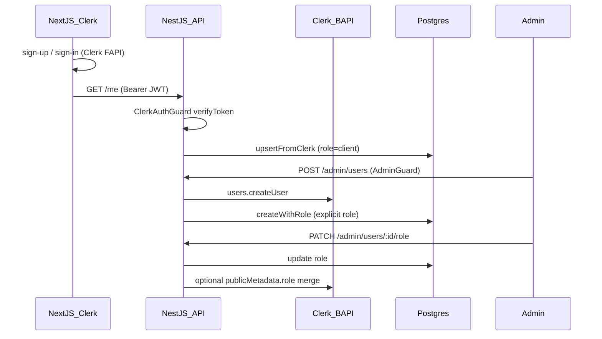

# Clerk admin user management (backend-only)

## Architecture boundary

**Frontend (Next.js — separate repo):** Clerk sign-in/sign-up via `@clerk/nextjs` + FAPI. Never POST email/password to NestJS for login. Uses `getToken()` → `Authorization: Bearer <jwt>` on LF API calls.

**Backend (this repo):** `ClerkAuthGuard` (`verifyToken`), webhooks, `GET /me` upsert, `AdminGuard` + `users.role` in Postgres. Does **not** implement `/auth/login`, `/auth/register`, or FAPI proxy.



**RBAC stays in Postgres** (`users.role`) per [`docs/auth/clerk-supabase-sync.md`](docs/auth/clerk-supabase-sync.md). Clerk proves identity; admin elevation updates the DB (optional `public_metadata.role` mirror for Dashboard visibility—not used by guards).

---

## Out of scope (explicit)

- `POST /auth/sign-up`, `/auth/sign-in`, email verification steps
- FAPI proxy (`ClerkFapiService`, `attemptToken`, `AUTH_ATTEMPT_SECRET`)
- `CLERK_PUBLISHABLE_KEY`, `CLERK_FAPI_URL`
- Self-serve admin promotion endpoint

---

## Admin endpoints

Extend [`apps/src/modules/users/users.controller.ts`](apps/src/modules/users/users.controller.ts) and [`users.service.ts`](apps/src/modules/users/users.service.ts):

| Method | Path | Guard | Purpose |
|--------|------|-------|---------|
| `POST` | `/admin/users` | `ClerkAuthGuard` + `AdminGuard` | Provision user in Clerk (BAPI) + Postgres |
| `PATCH` | `/admin/users/:id/role` | `ClerkAuthGuard` + `AdminGuard` | Set role (`client` \| `chef` \| `admin`) |

**`POST /admin/users`** body: `email` (required), `password?`, `firstName?`, `lastName?`, `role?` (default `client`).

- BAPI: `clerk.users.createUser({ emailAddress, password, firstName, lastName, skipPasswordRequirement: !password })`
- BAPI **auto-verifies email** (Clerk limitation—document for admin provisioning)
- DB: `createWithRole` / upsert with requested `role`

**`PATCH /admin/users/:id/role`** body: `{ role: 'admin' | 'chef' | 'client' }`

- Update `users.role` in Postgres (source of truth)
- Optional: merge `publicMetadata.role` on Clerk user

**Real `CLERK_SECRET_KEY` required** for `POST /admin/users`. Return `503 Service Unavailable` when `sk_test_placeholder` (same pattern as webhooks missing signing secret).

---

## UsersService changes

In [`apps/src/modules/users/users.service.ts`](apps/src/modules/users/users.service.ts):

- `createWithRole(input)` — persist row with explicit role after Clerk user exists
- `updateRole(userId, role)` — admin role change; optional Clerk metadata sync
- `provisionAdminUser(input)` — BAPI create + DB persist; maps Clerk errors to HTTP exceptions
- Refactor `upsertFromClerk` — optional `role` on create; update role only when explicitly passed (webhook/`GET /me` paths omit role)

---

## ClerkService

Add [`apps/src/integrations/clerk.service.ts`](apps/src/integrations/clerk.service.ts):

- Singleton `createClerkClient({ secretKey })` when `isRealClerkSecretKey`
- `configured` getter; register in `IntegrationsModule`

---

## First admin bootstrap

No self-serve admin promotion. One-time setup:

1. User signs up via Next.js Clerk UI (or admin provisions them)
2. Promote via SQL/Prisma Studio: `UPDATE users SET role = 'admin' WHERE email = '…'`
3. Subsequent admins via `PATCH /admin/users/:id/role`

---

## Tests

Focused unit tests (mock BAPI, no live Clerk):

- `users.service.spec.ts` — `createWithRole`, `updateRole`, `provisionAdminUser` (503 on placeholder key, happy path)
- `users.controller.spec.ts` — admin endpoints delegate to service
- `clerk.service.spec.ts` — configured vs placeholder key

---

## Documentation

- [`docs/auth/clerk-integration-contract.md`](docs/auth/clerk-integration-contract.md) — frontend/backend boundary, admin provisioning, bootstrap
- [`docs/auth/clerk-supabase-sync.md`](docs/auth/clerk-supabase-sync.md) — link contract; admin routes
- [`AGENTS.md`](AGENTS.md) — admin endpoints, real Clerk key for provisioning
- [`docs/evolution/platform-spec-alignment-evolution.md`](docs/evolution/platform-spec-alignment-evolution.md) — auth module status
- [`apps/README.md`](apps/README.md) — endpoint table

---

## Frontend contract (Next.js)

```typescript
// After Clerk session active
const token = await getToken()
const me = await fetch(`${API}/me`, {
  headers: { Authorization: `Bearer ${token}` },
})
// Use me.role for routing; never rely on Clerk metadata alone for RBAC
```

Admin dashboard calls `POST /admin/users` and `PATCH /admin/users/:id/role` with the same Bearer token (caller must have `users.role = admin`).
