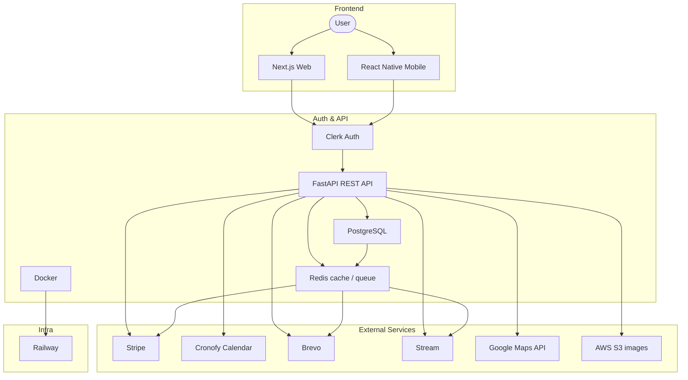

# LF BackEnd

Monolithic backend for the Labs Food architecture: REST API (OpenAPI/Swagger), Docker, and integrations fixed in `[stack.md](./stack.md)`.

## Stack summary

| Layer                           | Choice                                                             |
| ------------------------------- | ------------------------------------------------------------------ |
| REST API                        | FastAPI (OpenAPI/Swagger)                                          |
| Runtime / application framework | Node.js, **NestJS** with **Fastify** adapter                       |
| Database                        | PostgreSQL                                                         |
| Cache & queues                  | Redis (availability/slots cache; async jobs: email, notifications) |
| Containers                      | Docker                                                             |
| Hosting                         | **Railway**                                                        |

## Third-party services

| Domain                              | Service                             |
| ----------------------------------- | ----------------------------------- |
| Auth (OAuth2 Google/Apple)          | [Clerk](https://clerk.com/)         |
| Calendar / provider availability    | [Cronofy](https://www.cronofy.com/) |
| Realtime chat (clients ↔ providers) | [Stream](https://getstream.io/)     |
| Transactional email                 | [Brevo](https://www.brevo.com/)     |
| Payments                            | [Stripe](https://stripe.com/)       |
| Maps & routing                      | Google Maps API                     |
| Object storage                      | AWS S3                              |

## Frontends (outside this repo)

- **Web:** Next.js, Tailwind CSS  
- **Mobile:** React Native

## High-level flow

1. **Clients** — Next.js or React Native; sign-in via **Clerk**.
2. **API** — Bookings and profiles hit the backend; **PostgreSQL** holds users, profiles, providers, bookings, availability; **Redis** caches hot paths and backs async work.
3. **Integrations** — **Stripe**, **Cronofy**, **Brevo**, **Stream**, **Google Maps**, and **S3** are used from the backend as needed.
4. **Deploy** — Backend, PostgreSQL, and Redis run in **Docker** on **Railway**; frontends deploy on their own hosts (for example Vercel, Netlify, or Railway).

## Repository layout (planned)

This repository is the **backend** piece. Service code (`Dockerfile`, migrations, NestJS/FastAPI apps) will appear here as the implementation grows.

## Getting started

1. Clone the repository.
2. `cp .env.example .env` and set secrets and URLs (see comments in `[.env.example](./.env.example)`).
3. Run PostgreSQL and Redis locally or via Docker; start the API once the app entrypoint exists.
4. When a Compose file is added, prefer `docker compose up` for a full local stack.

## Documentation

- `[stack.md](./stack.md)` — architecture notes and Mermaid source diagram.

