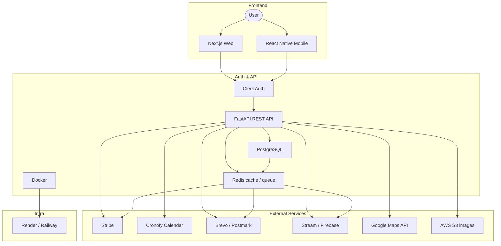

# LF BackEnd

Monolithic backend for the Labs Food architecture: REST API (OpenAPI/Swagger), containerised deployment, and integrations with auth, payments, calendar, messaging, and storage.

Full stack decisions and diagrams live in [`stack.md`](./stack.md).

## Stack summary

| Layer | Choice |
|--------|--------|
| API | FastAPI (REST + Swagger) |
| Optional long-term / MVP alt | NestJS + Fastify adapter, Node runtime |
| Database | PostgreSQL |
| Cache & queues | Redis (availability/slots cache, async jobs: email, notifications) |
| Containers | Docker |
| Hosting | Render or Railway |

## Third-party services

- **Auth** — OAuth2 (Google/Apple) via [Clerk](https://clerk.com/)
- **Scheduling** — [Cronofy](https://www.cronofy.com/) (provider availability / calendar)
- **Realtime** — Stream or Firebase (client ↔ provider chat)
- **Email** — Brevo (free tier) or Postmark (deliverability)
- **Payments** — Stripe
- **Maps** — Google Maps API
- **Object storage** — AWS S3 (photos, documents)

## High-level flow

1. **Clients** — Next.js (web) or React Native (mobile); sign-in through Clerk.
2. **API** — Bookings and profiles go through the backend REST API; PostgreSQL persists users, providers, bookings, availability; Redis caches hot paths and backs async work.
3. **Integrations** — Stripe, Cronofy, email, chat, Maps, and S3 are called from the backend as needed.
4. **Deploy** — Backend, PostgreSQL, and Redis run in Docker on Render or Railway; frontends deploy separately (e.g. Vercel, Netlify, Render).

## Repository layout (planned)

This repo is the **backend** piece. Application code (FastAPI/NestJS apps, `Dockerfile`, migrations) will land here as the implementation grows. See `stack.md` for the full product architecture including frontends.

## Getting started

Prerequisites: Docker (recommended), or local PostgreSQL + Redis when services are added.

1. Clone the repository.
2. Copy environment templates once they exist (`cp .env.example .env`) and fill secrets (Clerk, Stripe, DB URLs, etc.).
3. Run the stack via Docker Compose when a `compose` file is added.

Details will be updated as the first service and compose definitions are committed.

## Documentation

- [`stack.md`](./stack.md) — schema, technos, infra, and Mermaid flow (source of truth for stack choices).
