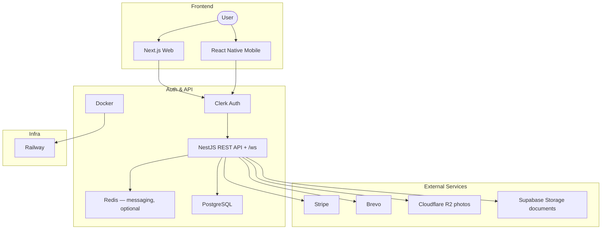

# LF BackEnd

Monolithic backend for the Labs Food architecture: REST API (OpenAPI/Swagger) on **NestJS + Fastify**, Docker, and the integrations listed in [stack.md](./stack.md).

> **Envie de lancer tout le projet LabsFood en local (les 4 repos, backend +
> les 3 apps front) en une commande ?** Voir **[LOCAL_SETUP.md](./LOCAL_SETUP.md)**.

## Stack summary

| Layer                           | Choice                                                                        |
| ------------------------------- | ----------------------------------------------------------------------------- |
| Runtime / application framework | Node.js 24, **NestJS 11** with **Fastify** adapter                            |
| REST API                        | NestJS controllers + `@nestjs/swagger` (OpenAPI/Swagger)                      |
| ORM / migrations                | **Prisma 7** (`apps/prisma/`)                                                 |
| Database                        | PostgreSQL 16 (Supabase in production)                                        |
| Realtime & rate limits          | Redis 7, optional (messaging)                                                 |
| Containers                      | Docker / Docker Compose                                                       |
| Hosting                         | **Railway**                                                                   |

> **Node version.** Every stage of [`apps/Dockerfile`](./apps/Dockerfile), `.nvmrc` and `apps/.nvmrc`
> pin the same Node (24.22.1), so nvm, the CI lint and test job and the image all run it. CI fails
> if they disagree, and Dependabot opens the PR for each new `node:24` image.

## Third-party services

| Domain                          | Service                                                                    |
| ------------------------------- | -------------------------------------------------------------------------- |
| Auth (OAuth2 Google/Apple)      | [Clerk](https://clerk.com/)                                                |
| Realtime chat (clients ↔ chefs) | In-house: PostgreSQL + REST + WebSocket (`modules/messaging`)              |
| Transactional email             | [Brevo](https://www.brevo.com/) (templates in [`brevo/`](./brevo/README.md)) |
| Payments                        | [Stripe](https://stripe.com/) (Connect, Checkout, SEPA)                    |
| Object storage                  | Cloudflare R2 (public photos), Supabase Storage (KYC documents, message attachments) |
| Calendar / chef availability    | |
| Maps & routing                  | Google Maps API — key configured, not used yet                             |

## Frontends (outside this repo)

- **Web:** Next.js, Tailwind CSS
- **Mobile:** React Native

## High-level flow

1. **Clients** — Next.js or React Native; sign-in via **Clerk**.
2. **API** — Every product flow hits the NestJS backend; **PostgreSQL** holds users and profiles, candidatures and KYC documents, dishes and menus, quotes and bookings, conversations, payments and the audit log; **Redis** (optional) carries the messaging rate limit and realtime events between instances.
3. **Integrations** — **Stripe**, **Brevo**, **Cloudflare R2** and **Supabase Storage** are called from the backend. Google Maps are configured but not used yet.
4. **Deploy** — The backend runs in **Docker** on **Railway**, against Supabase Postgres; frontends deploy on their own hosts.



## Repository layout

```bash
apps/                  # NestJS + Fastify primary API (src/, prisma/, package.json)
brevo/                 # Brevo email templates (HTML sources, tests, upload script)
docs/
  architecture.md      # backend architecture
  auth/                # Clerk integration contract and Clerk ↔ Postgres sync
  payments/            # Stripe payment flow & webhook contract
  deploy/              # Railway production checklist
  evolution/           # payments change register
local-dev/             # full-stack Compose file for the 4 repos (see LOCAL_SETUP.md)
docker-compose.yml     # postgres, redis, api (local); Railway uses apps/Dockerfile
.env.example           # template for required environment variables
stack.md               # backend stack and decisions
```

## API endpoints

Use the **public Railway domain** for production (browser, Swagger, frontends, `curl` from your machine).
Do **not** use `https://<service>.railway.internal` — that hostname is **private** (service-to-service inside Railway only).

| Endpoint          | Local                                                                    | Production (public)                          |
| ----------------- | ------------------------------------------------------------------------ | -------------------------------------------- |
| Base API          | [http://localhost:8000](http://localhost:8000)                           | `https://lf-api.labsfood.fr`                 |
| Swagger UI        | [http://localhost:8000/docs](http://localhost:8000/docs)                 | `https://lf-api.labsfood.fr/docs`            |
| OpenAPI JSON      | [http://localhost:8000/openapi.json](http://localhost:8000/openapi.json) | `https://lf-api.labsfood.fr/openapi.json`    |
| Health (liveness) | [http://localhost:8000/health](http://localhost:8000/health)             | `https://lf-api.labsfood.fr/health`          |
| Readiness (DB)    | [http://localhost:8000/ready](http://localhost:8000/ready)               | `https://lf-api.labsfood.fr/ready`           |
| Stripe webhook    | `http://localhost:8000/webhooks/stripe`                                  | `https://lf-api.labsfood.fr/webhooks/stripe` |

**Production `<custom-domain>`:** Railway → API service → **Settings** → **Networking** → **Generate domain** (or your custom domain). Example shape: `https://lf-backend-production-xxxx.up.railway.app`.

**Private (Railway only):** `http://lf-backend.railway.internal:<PORT>/…` — reachable from other services in the same Railway project, not from the public internet.

## Getting started

### 1. Configure environment

```bash
cp .env.example .env
# fill in CLERK_SECRET_KEY, STRIPE_SECRET_KEY, STRIPE_WEBHOOK_SECRET, … as needed
```

Payments need `STRIPE_SECRET_KEY` and `STRIPE_WEBHOOK_SECRET` (plus `STRIPE_CONNECT_WEBHOOK_SECRET`
on deployed environments); without the key the `/payments/*` routes answer `503`. The platform
commission is **15 % HT + 20 % VAT**: an admin sets it from the console
(`PATCH /admin/settings/commission`), and `PAYMENTS_COMMISSION_RATE_BPS=1500` is the fallback
until one is saved. See [docs/payments/stripe-payments-contract.md](./docs/payments/stripe-payments-contract.md).

### 2. Run with Docker Compose (local)

Requires **Docker Compose v2** (`docker compose`, plugin bundled with Docker Desktop / recent Engine). If `docker compose up --build` fails with `unknown flag: --build`, use a two-step build or the legacy hyphenated CLI:

```bash
# Compose v2 (recommended)
docker compose build api
docker compose up api

# Or one shot when your CLI supports it:
docker compose up --build api

# Legacy docker-compose v1 (hyphenated binary)
docker-compose build api && docker-compose up api
```

The `api` service starts `postgres` and `redis` first and points at them by default
(`postgresql://lf:lf@postgres:5432/lf_backend`, `redis://redis:6379/0`). To use another
database, set `DOCKER_SUPABASE_DB_URL` / `DOCKER_SUPABASE_DB_MIGRATION_URL` in repo-root `.env`;
inside Compose the Postgres host is **`postgres`**, not `localhost`.

Local URLs: see [API endpoints](#api-endpoints) above.

The `api` container runs **`prisma migrate deploy`** on startup, then starts the API.

### 3. Production on Railway

See **[docs/deploy/railway.md](./docs/deploy/railway.md)** — link GitHub repo, set Supabase pooler + migration URLs, Clerk, CORS, health check `/health`. Build and health check are set on the Railway service; image [apps/Dockerfile](./apps/Dockerfile).

After deploy, open Swagger at **`https://<public-domain>/docs`**. Smoke test:

```bash
export API_BASE="https://<custom-domain>"   # from Railway → Networking
curl -s "$API_BASE/health"
curl -s "$API_BASE/ready"
```

### 4. Run locally (without Docker API image)

```bash
# Start backing services only (add redis to test multi-instance messaging)
docker compose up -d postgres

cd apps
npm install
export SUPABASE_DB_URL="postgresql://lf:lf@localhost:5432/lf_backend"
export SUPABASE_DB_MIGRATION_URL="${SUPABASE_DB_MIGRATION_URL:-$SUPABASE_DB_URL}"
export CLERK_SECRET_KEY="sk_test_placeholder"
npm run db:migrate
npm run start:dev         # watch mode on port 8000
```

## Tooling

```bash
cd apps
npm run build     # prisma generate + nest build to dist/
npm run lint      # eslint (with prettier rules)
npm test          # jest unit tests
```

## Documentation

- [LOCAL_SETUP.md](./LOCAL_SETUP.md) — run the four LabsFood repos together with Docker.
- [AGENTS.md](./AGENTS.md) — development guide: local setup, auth testing, and the rules and routes of every feature.
- [stack.md](./stack.md) — backend stack, integrations, resolved decisions.
- [docs/architecture.md](./docs/architecture.md) — backend architecture.
- `docs/SPEC-BACKEND.md` (client API & domain spec), `docs/SPEC-ADMIN-DASHBOARD.md` (admin API spec) and `docs/evolution/platform-spec-alignment-evolution.md` (spec gap backlog) — **not in this repo**: removed in `559c4d6`; last copy with `git show 559c4d6^:docs/SPEC-BACKEND.md` (same for the others).
- [docs/auth/clerk-integration-contract.md](./docs/auth/clerk-integration-contract.md) — Clerk frontend ↔ backend contract.
- [docs/auth/clerk-supabase-sync.md](./docs/auth/clerk-supabase-sync.md) — Clerk ↔ Postgres sync, webhooks, backfill scripts.
- [docs/payments/stripe-payments-contract.md](./docs/payments/stripe-payments-contract.md) — payment flow, Stripe Connect, commissions, webhook contract.
- [docs/evolution/payments-stripe-cb-evolution.md](./docs/evolution/payments-stripe-cb-evolution.md) — payments change register.
- [docs/deploy/railway.md](./docs/deploy/railway.md) — Railway production deploy checklist.
- [docs/database-connection.md](./docs/database-connection.md) — Supabase pooler vs direct URLs, Prisma migrations.
- [brevo/README.md](./brevo/README.md) — email templates: add, edit, upload.
