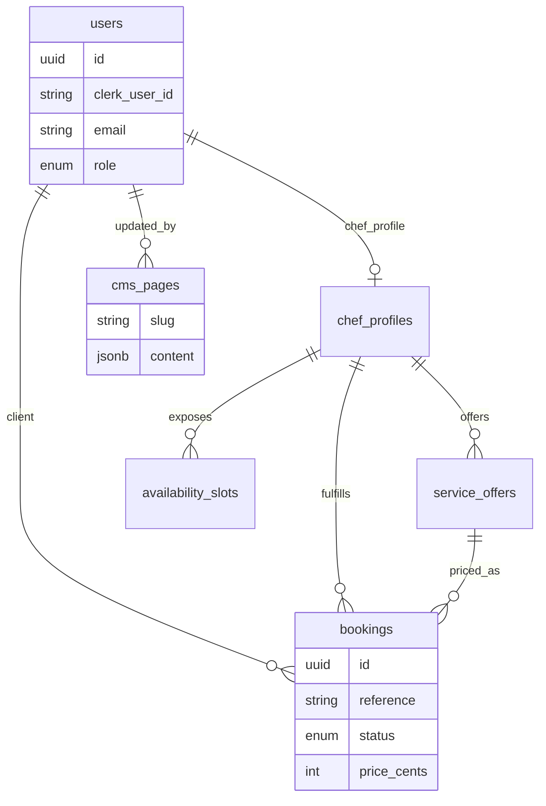
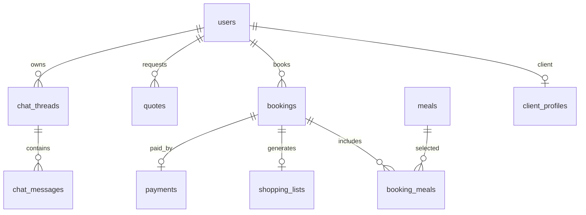
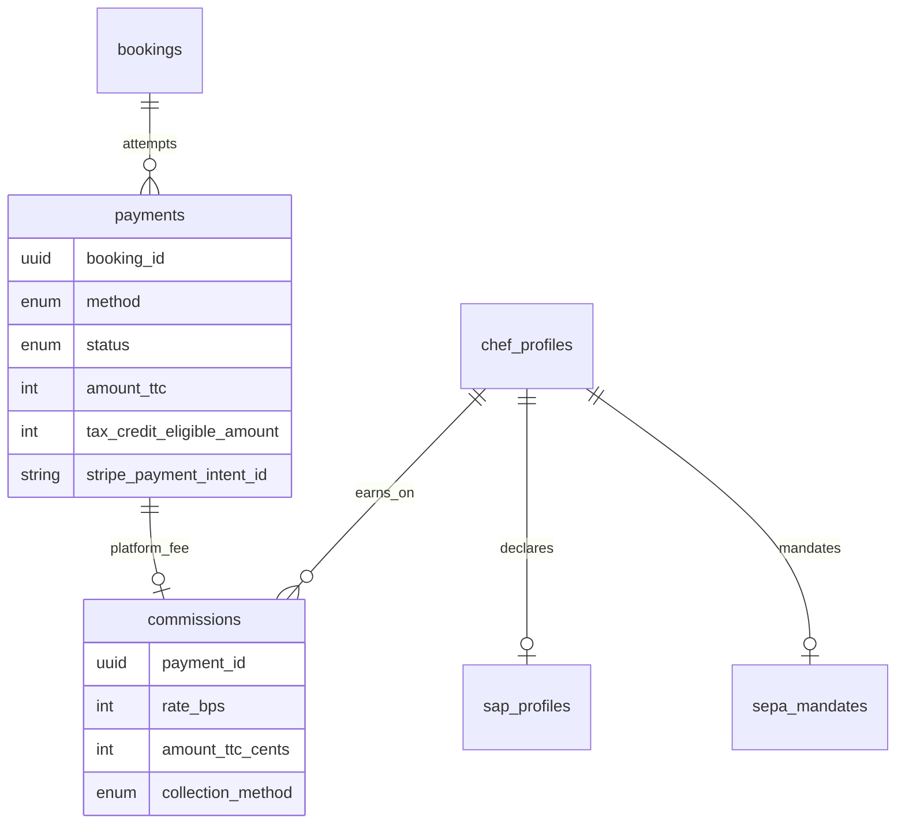
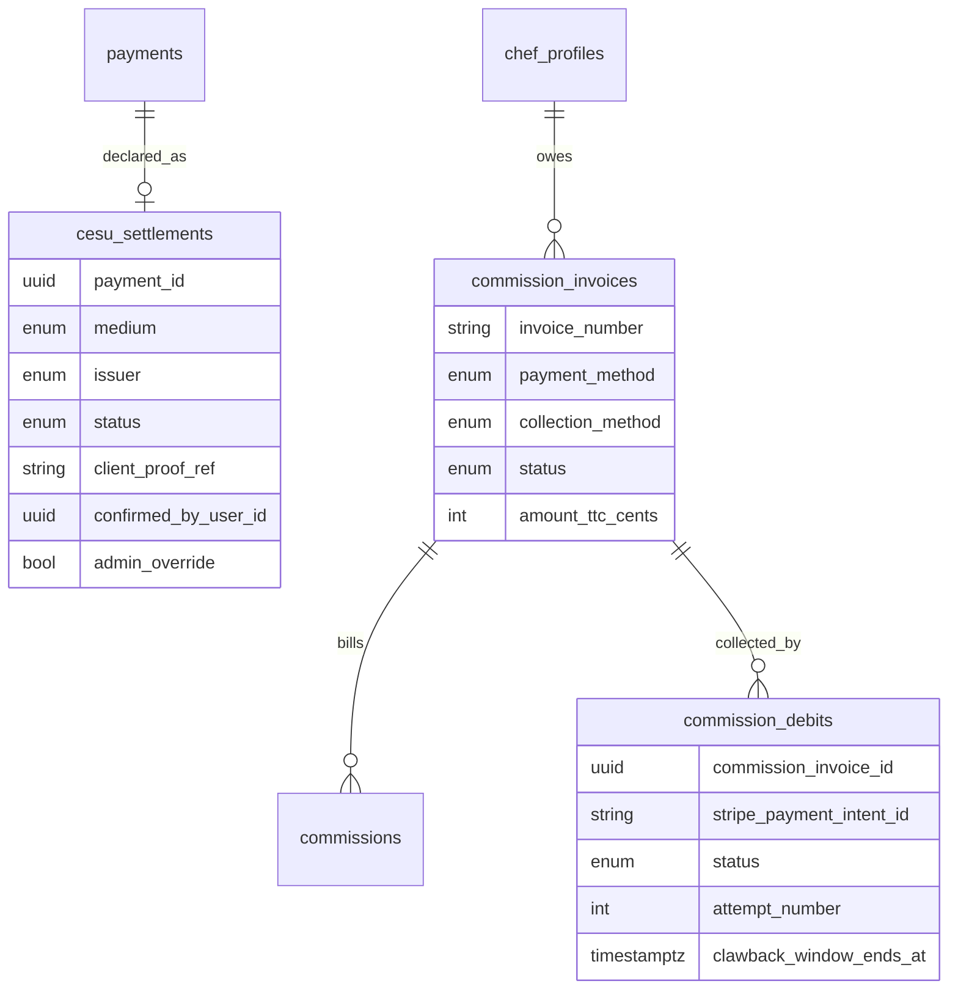
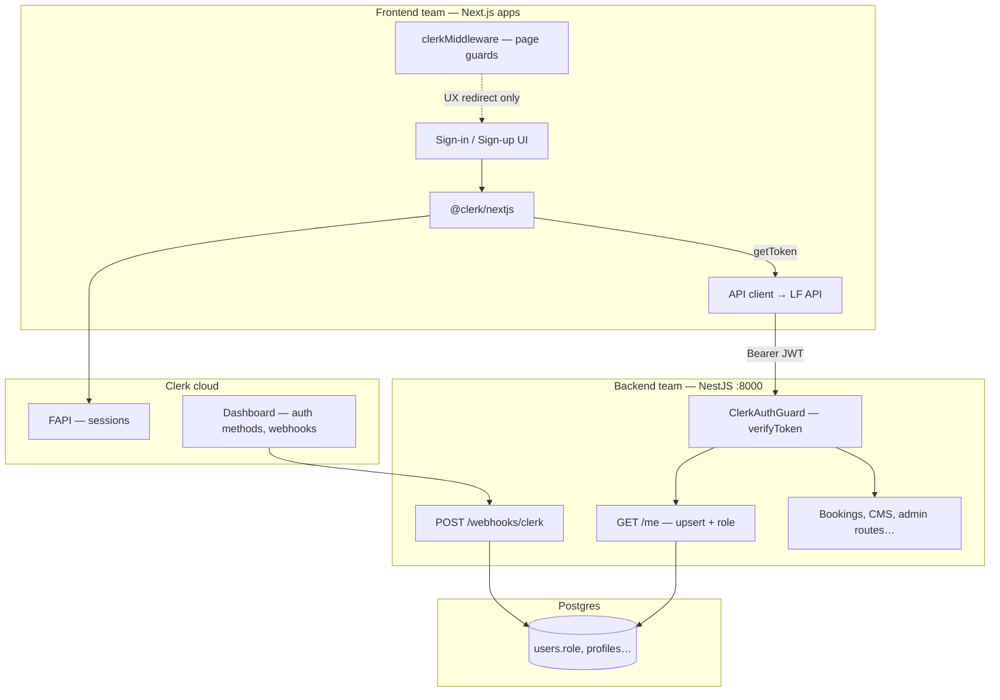

# Backend architecture

This document describes the **LF-BackEnd** API only. Product intent and route contracts come from `[SPEC-BACKEND.md](./SPEC-BACKEND.md)` and `[SPEC-ADMIN-DASHBOARD.md](./SPEC-ADMIN-DASHBOARD.md)` (API sections). Stack choices are in `[../stack.md](../stack.md)`.

## Guiding specs


| Document                                               | Backend scope                                                                                                 |
| ------------------------------------------------------ | ------------------------------------------------------------------------------------------------------------- |
| `[SPEC-BACKEND.md](./SPEC-BACKEND.md)`                 | Client/batch-cooking API, shared domain model, payments, notifications, stats                                 |
| `[SPEC-ADMIN-DASHBOARD.md](./SPEC-ADMIN-DASHBOARD.md)` | Admin REST surface (`/admin/*`), admin-only entities (Kossam, applications, contact, reviews, team, settings) |


Frontend apps (`labs-food`, `admin-labsfood`, `labs-food-main`) consume this API but are **not** documented here.

## Resolved implementation choices


| Topic             | Decision                                                                                             | Notes                                                                                  |
| ----------------- | ---------------------------------------------------------------------------------------------------- | -------------------------------------------------------------------------------------- |
| ORM               | **Prisma**                                                                                           | `PrismaService` + `apps/prisma/schema.prisma`                                          |
| Auth              | **Clerk**                                                                                            | No first-party `/auth/register` or password routes; JWT from Clerk on protected routes |
| Booking aggregate | `**bookings`**                                                                                       | Spec “reservation” maps to existing booking module/table naming                        |
| Chef role         | `**chef**` replaces `provider`                                                                       | E1 migration landed; `provider_id` columns kept temporarily for compatibility          |
| Calendar / chat   | **Cronofy** + **Stream**                                                                             | Kept per stack; wire to booking lifecycle and messaging modules                        |
| Tracking          | `[evolution/platform-spec-alignment-evolution.md](./evolution/platform-spec-alignment-evolution.md)` | Gap list and delivery status                                                           |


## Services in this repo


| Service    | Path                              | Role                                          | Default port |
| ---------- | --------------------------------- | --------------------------------------------- | ------------ |
| NestJS API | `[apps/](../apps/)` (`apps/src/`) | Primary REST API (OpenAPI/Swagger)            | 8000         |
| PostgreSQL | Docker / Supabase                 | Primary data store                            | 5432         |
| Redis      | Docker                            | Cache + async queues (module not enabled yet) | 6379         |


Database: **Prisma** (`apps/prisma/schema.prisma`). Local/Docker: `npm run db:migrate` or `prisma migrate deploy` in the API container entrypoint.

## Current module layout (implemented)

```
apps/src/
├── main.ts
├── app.module.ts
├── config/                    # env validation (Joi), config loader
├── prisma/
│   ├── schema.prisma
│   ├── migrations/
│   └── seed.ts
├── supabase/                  # DB module wrapper + shared types
│   ├── database.module.ts     # imports PrismaModule
│   ├── types/                 # CMS JSON shapes
│   └── enums.ts
├── auth/                      # ClerkAuthGuard, AdminGuard, CurrentClerkUser
├── integrations/              # Stripe, Cronofy, Stream, Brevo, Supabase (CMS assets)
├── redis/                     # scaffold (commented out of AppModule)
└── modules/
    ├── health/                # GET /health, GET /ready
    ├── users/                 # GET /thisUser, /me, /me/profile, /admin/clients/*
    ├── bookings/              # GET /bookings + detail routes with shopping list
    ├── catalog/               # /menus/current + admin meals/menu-weeks/formules
    ├── quotes/                # client/admin quote lifecycle
    ├── shopping-lists/        # ingredient aggregation service
    ├── stats/                 # /me/dashboard, /me/stats, /admin/dashboard
    ├── payments/              # /payments/intent, /payments/cesu, Stripe Connect, SEPA mandate
    │                          # + commission debits (facture B), fiscal attestations
    ├── stripe-webhooks/       # POST /webhooks/stripe (raw-body signature check)
    ├── clerk-webhooks/        # POST /webhooks/clerk (Svix)
    └── content-cms/           # GET /content/concept, PUT /content/concept (F19)
```

Reserved: `modules/content/` for non-CMS app content.

## Target backend modules (from specs)

Modules below are the **planned** NestJS boundaries. None except those in “Current” are fully implemented.


| Module           | Responsibility                                        | Primary routes (spec)                                           |
| ---------------- | ----------------------------------------------------- | --------------------------------------------------------------- |
| `auth`           | Clerk session bridge, role resolution                 | *(no password routes)* — use Clerk + `UsersService` upsert      |
| `users`          | User row + **client profile** (CRM fields)            | `GET/PATCH /me/profile`, account/settings/GDPR                  |
| `catalog`        | Meals, weekly menu, formules                          | `GET /menus/current`; admin meals/menu-weeks/formules           |
| `bookings`       | Session lifecycle, reference `LF-…`, meals on booking | `GET /me/bookings`*, `POST /bookings`, cancel; admin list/patch |
| `shopping-lists` | Ingredient aggregation by aisle                       | Embedded in booking detail + admin                              |
| `quotes`         | Sur-mesure requests & quotes                          | `POST /quotes`, `/me/quotes`, admin `/admin/quotes`             |
| `messaging`      | Threads + Stream realtime                             | `/me/thread`, `/admin/threads`                                  |
| `payments`       | **Done** — Connect destination charges, prefinanced CESU, commission invoices + SEPA debits, SAP/SEPA, tax credit | `/payments/intent`, `/payments/cesu`, `/webhooks/stripe`, `/me/chef-profile/stripe-connect/*`, `/me/chef/cesu-payments/*`, `/admin/commission-invoices/*`, fiscal attestations |
| `kossam`         | Kossam product orders                                 | Admin `/admin/kossam-orders`; public submit from main site      |
| `recruitment`    | Chef applications + documents                         | `/admin/applications`                                           |
| `contact`        | Site contact inbox                                    | `/admin/contact-messages`                                       |
| `reviews`        | Moderation & publish                                  | `/admin/reviews`                                                |
| `notifications`  | Email/SMS/in-app + preferences                        | Driven by booking/quote transitions                             |
| `stats`          | Dashboard aggregations                                | `GET /me/dashboard`, `GET /me/stats`, `GET /admin/dashboard`    |
| `admin`          | Guards, badges, settings singleton                    | `/admin/*`, `/admin/dashboard/badges`                           |
| `content-cms`    | Marketing “Notre Concept” page                        | **Done** — `/content/concept`                                   |
| `team`           | Chefs/staff & service zones                           | `/admin/team`, `/admin/zones`                                   |


Spec uses `/me/reservations`; implementation keeps `**bookings`** paths unless a versioned alias is added later.

## Booking lifecycle (target)

Spec state machine (stored on `bookings.status`):

```
pending → confirmed → shopping → cooking → delivered
                    ↘ cancelled
```

Phase 1 enum today: `pending`, `confirmed`, `cancelled`, `completed` — extend/rename toward spec on the bookings epic.

`POST /bookings` creates the booking as `pending`. The only automatic transition wired today is
`pending → confirmed`, driven by the Stripe `payment_intent.succeeded` webhook — the API never
confirms a booking on the client's word. A failed payment leaves the booking `pending` so the
client can retry. `shopping` / `cooking` / `delivered` remain unimplemented.

## Data model direction

### Implemented (Phase 1 + F19)




### Target additions (Prisma schema — spec-aligned)

Core shared entities: `ClientProfile`, `Meal`, `MenuWeek`, `Formule`, `BookingMeal` (junction), `ShoppingList`, `ShoppingItem`, `Quote`, `ChatThread`, `ChatMessage`, `Payment`, `Notification`.

Admin / main-site entities: `KossamOrder`, `KossamOrderItem`, `ChefApplication`, `ApplicationDocument`, `ContactMessage`, `Review`, `TeamMember`, `ServiceZone`, `AdminSettings`.

Logical ER (target — names follow spec; table `bookings` retained):




`chef_profiles` can later converge with team modeling (`TeamMember`, chef assignment on `bookings`) in a later design pass.

### Payments (implemented — `20260831120000_payments_sap_sepa_foundations`)



`payments` is **1:N** on `bookings` (a failed card attempt is retried with a fresh PaymentIntent),
and `commissions` freezes the rate and VAT in force so a later rate change cannot rewrite history.
`chef_profiles` carries three Stripe flags mirrored from `account.updated`. Full rationale:
[`payments/stripe-payments-contract.md`](./payments/stripe-payments-contract.md).

### CESU and commission debits (implemented — `20260905120000_payments_cesu_commission_debits`)



On a **prefinanced CESU** payment the funds never transit through the platform: the client
pays from their issuer's beneficiary area using the chef's CRCESU number (NAN), the issuer
credits the chef directly, and no issuer exposes an API — so the **chef** confirms receipt,
with a traced admin override. The commission cannot be withheld at charge time, so it is
invoiced as **facture B** (`commission_invoices`, `LF-COM-<year>-NNNN`) and collected by
SEPA direct debit. The invoice always precedes the debit — it is the legal basis it
collects against — and a failed debit adds an attempt without cancelling the receivable, so
numbers never develop holes.

Stripe supports only the SEPA **CORE** scheme, whose 8-week "no questions asked" revocation
is recorded on `commission_debits.clawback_window_ends_at`; a chef with an uncollectable
commission stops receiving bookings and payments. `stripe_event_logs` de-duplicates webhook
deliveries on **`processed_at`**, and a `payment_intent` event is routed to the commission
engine or the client flow by a lookup in `commission_debits` — never by `metadata`, which a
`Dispute` leaves empty and a `Mandate` does not carry at all.

## Authentication

- `ClerkAuthGuard` — Bearer JWT, payload decode (JWKS verification planned).
- `@CurrentClerkUser()` — exposes Clerk `sub` and email in controllers.
- `AdminGuard` — requires persisted `UserRole.ADMIN` after Clerk auth.
- Future: `ChefGuard` or scoped queries for `UserRole.CHEF`.




Protected today: `/thisUser`, `/me`, `/bookings`, `/payments/*`, `/me/chef-profile/*`, `/me/fiscal-attestations/*`, `PUT /content/concept`; `/admin/*` additionally requires the persisted `admin` role. Public: `/health`, `/ready`, `GET /content/concept`, `GET /menus/current`.

`POST /webhooks/clerk` and `POST /webhooks/stripe` are public but **signature-verified** against the raw request bytes (Svix and Stripe respectively). The Fastify `preParsing` hook in `apps/src/main.ts` captures the raw body for the paths listed in `apps/src/auth/fastify-raw-body.ts` — a re-serialised JSON body would fail verification.

## Integrations


| Service      | Config                                       | Status                                          |
| ------------ | -------------------------------------------- | ----------------------------------------------- |
| Stripe       | `STRIPE_SECRET_KEY`, `STRIPE_WEBHOOK_SECRET`, `PAYMENTS_COMMISSION_*_BPS`, `PAYMENTS_COMMISSION_DEBIT_*`, `PAYMENTS_COMMISSION_INVOICE_PREFIX`, `STRIPE_CONNECT_*_URL` | **Live** — Connect destination charges, commissions, CESU commission invoices collected by SEPA direct debit, `POST /webhooks/stripe`, SEPA mandates |
| Cronofy      | `CRONOFY_*`                                  | Scaffold; link to chef availability             |
| Stream       | `STREAM_*`                                   | Scaffold; link to messaging module              |
| Brevo        | `BREVO_*`                                    | Scaffold; notification templates pending        |
| AWS S3       | `AWS_*`                                      | Config only; uploads pending                    |
| Supabase API | `SUPABASE_*`, CMS bucket                     | Optional CMS asset storage                      |


## Health checks

- `GET /health` — liveness, no backing services.
- `GET /ready` — Postgres ping (+ Redis when enabled).

## API surface summary

### Implemented


| Method | Route               | Auth                     |
| ------ | ------------------- | ------------------------ |
| GET    | `/health`, `/ready` | public                   |
| GET    | `/content/concept`  | public                   |
| PUT    | `/content/concept`  | admin                    |
| GET    | `/thisUser`, `/me`  | Clerk                    |
| GET    | `/bookings`         | Clerk                    |
| POST   | `/bookings`         | Clerk                    |
| POST   | `/payments/intent`  | Clerk (booking owner)    |
| POST   | `/payments/cesu`, GET `/me/bookings/:id/payment-status` | Clerk (booking owner) |
| GET    | `/chefs/:id/cesu-info` | **Public** (chef CRCESU number, needed before paying) |
| GET/POST | `/me/chef/cesu-payments*`, GET `/me/chef/commission-invoices` | Clerk (chef) |
| POST   | `/me/chef-profile/stripe-connect/link`, GET `…/status` | Clerk (chef) |
| POST   | `/me/chef-profile/sepa-mandate/setup-intent`, GET `/me/chef-profile/sepa-mandate` | Clerk (chef) |
| GET/PATCH | `/me/chef-profile/sap` | Clerk (chef)          |
| GET    | `/me/fiscal-attestations/:year` | Clerk           |
| GET    | `/admin/fiscal-attestations[/:clientId]` | admin  |
| POST   | `/webhooks/stripe`  | Stripe signature (public) |
| POST   | `/webhooks/clerk`   | Svix signature (public)  |


### Client / public backlog (SPEC-BACKEND)

`GET /me/dashboard`, `/me/bookings` (or alias), booking detail/cancel, `/menus/current`, quotes, `/me/thread`, `/me/profile`, `/me/stats`, account/GDPR routes. Payments (`/payments/intent`, `/webhooks/stripe`) are **delivered** — see above.

### Admin backlog (SPEC-ADMIN-DASHBOARD)

`/admin/dashboard`, `/admin/dashboard/badges`, reservations (bookings), quotes, threads, clients, meals, menu-weeks, formules, kossam-orders, applications, contact-messages, reviews, team, zones, settings.

## Documentation map


| File                                                                                                 | Role                        |
| ---------------------------------------------------------------------------------------------------- | --------------------------- |
| `[features/f19-concept-cms.md](./features/f19-concept-cms.md)`                                       | F19 scope (shipped)         |
| `[evolution/f19-concept-cms-evolution.md](./evolution/f19-concept-cms-evolution.md)`                 | F19 change register         |
| `[evolution/platform-spec-alignment-evolution.md](./evolution/platform-spec-alignment-evolution.md)` | Platform spec gap & backlog |
| `[payments/stripe-payments-contract.md](./payments/stripe-payments-contract.md)`                     | Payment flow, webhooks, commission |
| `[evolution/payments-stripe-cb-evolution.md](./evolution/payments-stripe-cb-evolution.md)`           | Payments change register    |
| `[database-connection.md](./database-connection.md)`                                                 | Supabase URLs               |
| `[Revisions_followup.md](./Revisions_followup.md)`                                                   | Release register            |


