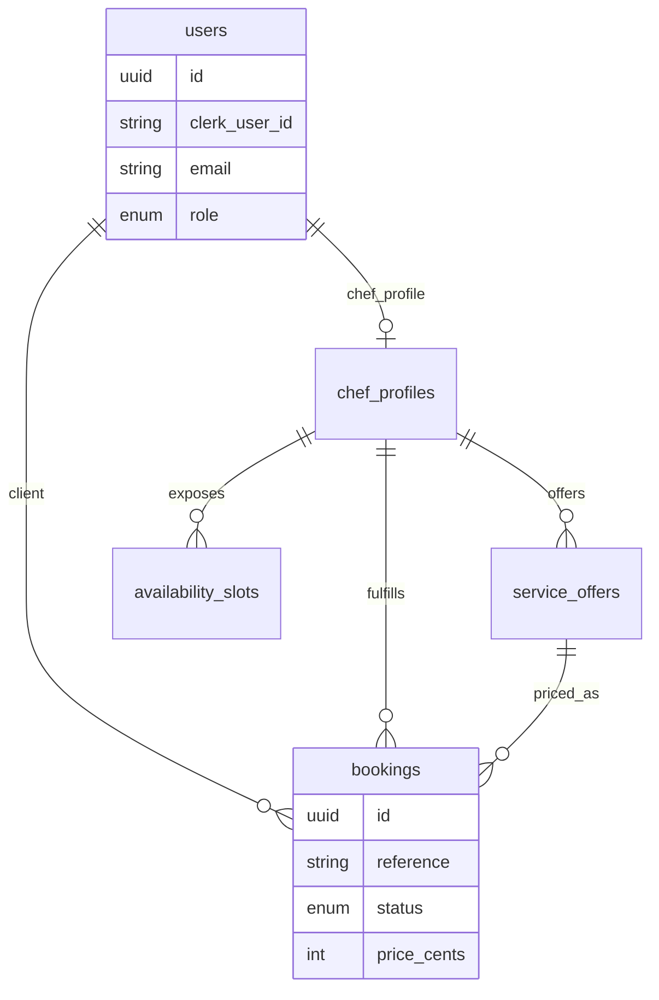
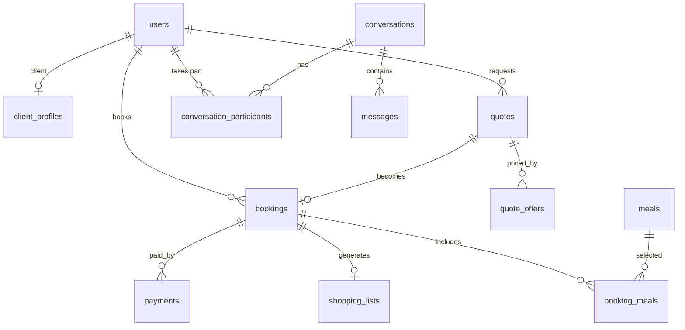
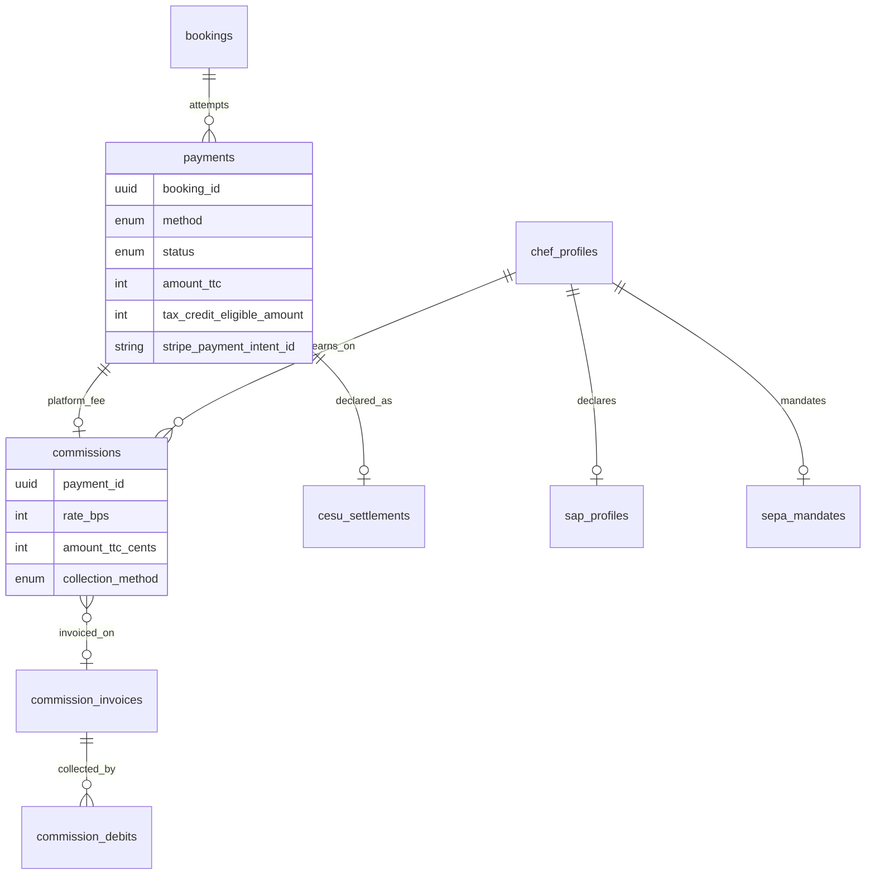
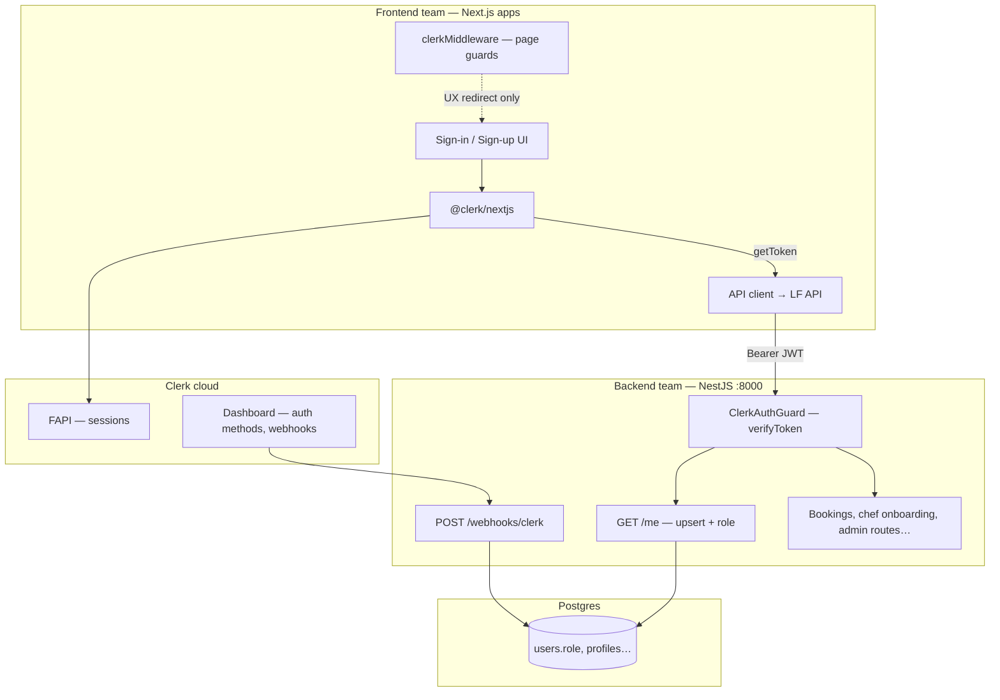

# Backend architecture

This document describes the **LF-BackEnd** API only. Product intent and route contracts come from [SPEC-BACKEND.md](./SPEC-BACKEND.md) and [SPEC-ADMIN-DASHBOARD.md](./SPEC-ADMIN-DASHBOARD.md) (API sections). Stack choices are in [../stack.md](../stack.md). The rules and routes of each delivered feature are in [../AGENTS.md](../AGENTS.md).

## Guiding specs

| Document                                             | Backend scope                                                                                                 |
| ---------------------------------------------------- | ------------------------------------------------------------------------------------------------------------- |
| [SPEC-BACKEND.md](./SPEC-BACKEND.md)                 | Client/batch-cooking API, shared domain model, payments, notifications, stats                                 |
| [SPEC-ADMIN-DASHBOARD.md](./SPEC-ADMIN-DASHBOARD.md) | Admin REST surface (`/admin/*`), admin-only entities (Kossam, applications, contact, reviews, team, settings) |

Frontend apps (`batchcooking-web`, `labsfood-web`, the admin console) consume this API but are **not** documented here.

## Resolved implementation choices

| Topic             | Decision                                                                                             | Notes                                                                                      |
| ----------------- | ---------------------------------------------------------------------------------------------------- | ------------------------------------------------------------------------------------------ |
| ORM               | **Prisma**                                                                                           | `PrismaService` + `apps/prisma/schema.prisma`                                              |
| Auth              | **Clerk**                                                                                            | Sign-up via `POST /auth/register`; no password login routes; Clerk JWT on protected routes |
| Booking aggregate | **`bookings`**                                                                                       | Spec “reservation” maps to existing booking module/table naming                            |
| Chef role         | **`chef`** replaces `provider`                                                                       | E1 migration landed; `provider_id` columns kept for compatibility                          |
| Calendar / chat   | **Cronofy** (not wired yet); chat is in-house (`modules/messaging`), Stream dropped                  | One thread per client and chef pair, plus support; see AGENTS.md                           |
| Tracking          | [evolution/platform-spec-alignment-evolution.md](./evolution/platform-spec-alignment-evolution.md)   | Gap list and delivery status                                                               |

## Services in this repo

| Service    | Path                            | Role                                               | Default port |
| ---------- | ------------------------------- | -------------------------------------------------- | ------------ |
| NestJS API | [apps/](../apps/) (`apps/src/`) | Primary REST API (OpenAPI/Swagger) + `/ws`         | 8000         |
| PostgreSQL | Docker / Supabase               | Primary data store                                 | 5432         |
| Redis      | Docker                          | Messaging rate limit + realtime fan-out (optional) | 6379         |

Database: **Prisma** (`apps/prisma/schema.prisma`, migrations in `apps/prisma/migrations/`). Local/Docker: `npm run db:migrate` or `prisma migrate deploy` in the API container entrypoint.

## Current module layout (implemented)

```
apps/src/
├── main.ts                    # Fastify, helmet, CORS, raw-body hook, /ws adapter
├── swagger.ts                 # OpenAPI document (/docs, /openapi.json)
├── app.module.ts
├── config/                    # env validation (Joi), config loader, CORS allowlist
├── prisma/                    # PrismaService
├── generated/prisma/          # Prisma client (generated)
├── supabase/                  # DB module wrapper + shared enums
├── auth/                      # ClerkAuthGuard, AdminGuard, CurrentClerkUser, raw-body helper
├── common/                    # audit log, pagination DTO, Swagger helpers
├── integrations/              # Stripe, Brevo, Clerk, R2, Supabase Storage, Cronofy (scaffold)
├── redis/                     # optional connection (REDIS_URL), in-process fallback
└── modules/
    ├── health/                # GET /health, GET /ready
    ├── users/                 # /auth/register, /me, /me/profile, /me/chef-profile, /me/avatar, /admin/users, /admin/clients, /admin/chefs
    ├── chef-onboarding/       # candidatures, KYC documents, referentials, daily dossier job (FLOW-01)
    ├── dishes/                # chef dishes and menus, public vitrine, moderation, recipe sheet and shopping list (FLOW-02)
    ├── catalog/               # /menus/current + admin meals/menu-weeks/formules (Lab's Food content)
    ├── bookings/              # /bookings list and detail (POST answers 501)
    ├── quotes/                # custom requests and offers; accepting an offer creates the booking (BLK-10)
    ├── messaging/             # conversations, attachments, /ws gateway, unread-message emails
    ├── contact/               # public contact form + admin inbox
    ├── shopping-lists/        # ingredient aggregation service
    ├── stats/                 # /me/dashboard, /me/stats, /admin/dashboard
    ├── platform-settings/     # commission setting, GET /pricing-rules
    ├── payments/              # card (Checkout, PaymentIntent), CESU, immediate advance, commission invoices, Stripe Connect, SEPA, fiscal attestations (FLOW-03)
    ├── stripe-webhooks/       # POST /webhooks/stripe (raw-body signature check)
    └── clerk-webhooks/        # POST /webhooks/clerk (Svix)
```

## Target backend modules (from specs)

Modules below are the NestJS boundaries the specs call for, with where each one stands.

| Module           | Responsibility                                        | Status / primary routes                                                          |
| ---------------- | ----------------------------------------------------- | -------------------------------------------------------------------------------- |
| `auth`           | Clerk session bridge, role resolution                 | **Done** — Clerk + `UsersService` upsert; `POST /auth/register`                  |
| `users`          | User row + **client profile** (CRM fields)            | **Done** — `GET/PATCH /me/profile`, `/admin/clients`; account/GDPR routes to do  |
| `catalog`        | Meals, weekly menu, formules                          | **Done** — `GET /menus/current`; admin meals/menu-weeks/formules                 |
| `bookings`       | Session lifecycle, reference `LF-…`, meals on booking | Partial — list and detail; created by an accepted offer; cancel to do            |
| `shopping-lists` | Ingredient aggregation by aisle                       | **Done** — booking detail, `/chef-missions/:id/shopping-list`                    |
| `quotes`         | Sur-mesure requests & offers                          | **Done** — `POST /quotes`, `/me/quotes`, `/me/chef/quotes`, `/admin/quotes`      |
| `messaging`      | Conversations, attachments, `/ws` realtime            | **Done** — `/me/conversations`, `/admin/conversations`                           |
| `payments`       | Card, CESU, immediate advance, commissions, SAP/SEPA, tax credit | **Done** — see [payments/stripe-payments-contract.md](./payments/stripe-payments-contract.md) |
| `kossam`         | Kossam product orders                                 | To do — admin `/admin/kossam-orders`; public submit from main site               |
| `recruitment`    | Chef applications + documents                         | **Done** as `chef-onboarding` — `/chef-applications`, `/admin/chef-applications` |
| `contact`        | Site contact inbox                                    | **Done** — `POST /contact-messages`, `/admin/contact-messages`                   |
| `reviews`        | Moderation & publish                                  | To do — `/admin/reviews`                                                         |
| `notifications`  | Email/SMS/in-app + preferences                        | Partial — Brevo emails per flow; no in-app, SMS or preferences                   |
| `stats`          | Dashboard aggregations                                | **Done** — `GET /me/dashboard`, `GET /me/stats`, `GET /admin/dashboard`          |
| `admin`          | Guards, badges, settings singleton                    | Partial — `AdminGuard`, `/admin/settings/commission`; badges to do               |
| `team`           | Chefs/staff & service zones                           | Partial — `GET /admin/chefs` (read-only); zones to do                            |

Spec uses `/me/reservations`; implementation keeps **`bookings`** paths unless a versioned alias is added later.

## Booking lifecycle (target)

Spec state machine (stored on `bookings.status`):

```
pending → confirmed → shopping → cooking → delivered
                    ↘ cancelled
```

Enum today: `pending`, `confirmed`, `cancelled`, `completed` — extend/rename toward spec on the bookings epic.

A booking is created by accepting an offer (`POST /me/quotes/:id/offers/:offerId/accept`), directly
`confirmed`; `POST /bookings` answers `501`. A confirmed prestation is paid **after** it took place
and its status does not change when paid: "paid" is read from its payments. A `pending` booking
becomes `confirmed` once its payments cover it — settled by the Stripe webhook, a confirmed CESU
payment or the URSSAF answer, never on the client's word. `shopping` / `cooking` / `delivered`
remain unimplemented.

## Data model direction

### Implemented (Phase 1)



### Spec entities

Implemented: `ClientProfile`, `Meal`, `MenuWeek`, `Formule`, `BookingMeal` (junction), `ShoppingList`, `ShoppingItem`, `Quote` (+ `QuoteOffer`), `Conversation`, `ConversationParticipant`, `Message`, `MessageAttachment`, `Payment`, `ChefApplication` (+ `ChefDocument`), `ContactMessage`.

Not modelled yet: `Notification`, `KossamOrder`, `KossamOrderItem`, `Review`, `TeamMember`, `ServiceZone`, `AdminSettings` (the commission lives in `platform_settings`).

Logical ER (names follow spec; table `bookings` retained):



`chef_profiles` can later converge with team modeling (`TeamMember`, chef assignment on `bookings`) in a later design pass.

### Payments (implemented — `20260831120000_payments_sap_sepa_foundations`, `20260905120000_payments_cesu_commission_debits`, `20261013120000_urssaf_links`)



`payments` is **1:N** on `bookings` (a failed attempt is retried, and a booking can be split between
CESU and card), and `commissions` freezes the rate and VAT in force so a later rate change cannot
rewrite history. `chef_profiles` carries three Stripe flags mirrored from `account.updated`.
`urssaf_links` holds the immediate-advance enrolment per client and batch cooker. Full rationale:
[`payments/stripe-payments-contract.md`](./payments/stripe-payments-contract.md).

## Authentication

- `ClerkAuthGuard` — Bearer JWT verified with `@clerk/backend` `verifyToken`; decode-only when `CLERK_SECRET_KEY=sk_test_placeholder` (local).
- `@CurrentClerkUser()` — exposes Clerk `sub` and email in controllers.
- `AdminGuard` — requires persisted `UserRole.ADMIN` after Clerk auth.
- Chef and client resources are protected by ownership (the caller's profile), not by role; there is no `ChefGuard`.



Every route needs a Clerk bearer token unless listed as public; `/admin/*` additionally requires the persisted `admin` role. Public: `/health`, `/ready`, `POST /auth/register`, `POST /chef-applications`, `POST /contact-messages`, `GET /referentials/*`, `GET /menus/current`, `GET /menus/week`, `GET /chefs/:id`, `GET /chefs/:id/showcase`, `GET /chefs/:chefProfileId/cesu-info`, and the two webhooks.

`POST /webhooks/clerk` and `POST /webhooks/stripe` are public but **signature-verified** against the raw request bytes (Svix and Stripe respectively). The Fastify `preParsing` hook in `apps/src/main.ts` captures the raw body for the paths listed in `apps/src/auth/fastify-raw-body.ts` — a re-serialised JSON body would fail verification.

## Integrations

| Service       | Config                                                                                     | Status                                                                                                      |
| ------------- | ------------------------------------------------------------------------------------------ | ----------------------------------------------------------------------------------------------------------- |
| Stripe        | `STRIPE_SECRET_KEY`, `STRIPE_WEBHOOK_SECRET`, `STRIPE_CONNECT_WEBHOOK_SECRET`, `PAYMENTS_*`, `STRIPE_CONNECT_*_URL` | **Live** — Connect destination charges (Checkout + PaymentIntent), SEPA mandates and commission debits, `POST /webhooks/stripe` |
| Brevo         | `BREVO_API_KEY`, `BREVO_SENDER_*`, `BREVO_TPL_*`                                           | **Live** — transactional templates in [`brevo/`](../brevo/README.md); an unset template id skips that email |
| Cloudflare R2 | `R2_*`                                                                                     | Public dish, menu and profile photos (`R2StorageService`); routes answer 503 without all five vars          |
| Supabase API  | `SUPABASE_*`, `SUPABASE_KYC_BUCKET`, `SUPABASE_MESSAGING_BUCKET`                           | Private storage for chef KYC documents and message attachments                                              |
| URSSAF        | `URSSAF_GATEWAY`                                                                           | Simulated only (`disabled` by default): an admin answers in URSSAF's place                                  |
| Cronofy       | `CRONOFY_*`                                                                                | Scaffold; no route uses it                                                                                  |

## Health checks

- `GET /health` — liveness, no backing services.
- `GET /ready` — Postgres ping (Redis is not checked).

## API surface summary

### Implemented

Swagger (`/docs`) is the complete, current list. By area:

| Area                    | Routes                                                                                                   | Auth                    |
| ----------------------- | -------------------------------------------------------------------------------------------------------- | ----------------------- |
| Health                  | `GET /health`, `GET /ready`                                                                              | public                  |
| Account                 | `POST /auth/register`; `GET /thisUser`, `GET /me`, `/me/profile`, `/me/chef-profile`, `/me/avatar`       | public; Clerk           |
| Chef onboarding         | `/chef-applications`, `/me/chef-application`, `/me/chef-documents`, `/referentials/*`                    | public; Clerk           |
| Dishes & menus          | `/me/dishes`, `/me/menus`, `/me/showcase`, `/me/suggestions`, `/me/offers`, `/menus/week`, `/chefs/:id`  | Clerk; public           |
| Missions                | `/chef-missions/:id/*`, `GET /me/culinary-map`                                                           | Clerk                   |
| Bookings                | `GET /bookings/me`, `GET /bookings/me/bookings/:id`                                                      | Clerk                   |
| Quotes & offers         | `POST /quotes`, `/me/quotes`, `/me/chef/quotes`, `GET /pricing-rules`                                    | Clerk                   |
| Messaging               | `/me/conversations`, `/ws`                                                                               | Clerk                   |
| Payments                | `/payments/*`, `/me/bookings/:id/payment-*`, `/bookings/:id/settle`, `/me/urssaf-links`, `/me/chef/*`, `/me/chef-profile/{stripe-connect,sepa-mandate,sap}`, `/me/fiscal-attestations/:year` | Clerk |
| Contact                 | `POST /contact-messages`                                                                                 | public                  |
| Stats                   | `GET /me/dashboard`, `GET /me/stats`                                                                     | Clerk                   |
| Admin                   | everything under `/admin/*`, plus `GET /bookings` and `/bookings/admin/bookings/:id`                     | Clerk + `admin`         |
| Webhooks                | `POST /webhooks/stripe`, `POST /webhooks/clerk`                                                          | signature (public)      |

### Client / public backlog (SPEC-BACKEND)

Booking creation outside an offer and cancellation, account/notification settings, GDPR export and deletion routes, in-app notifications.

### Admin backlog (SPEC-ADMIN-DASHBOARD)

`/admin/dashboard/badges`, booking status changes and cancellation, kossam-orders, reviews, team & zones, settings beyond the commission.

## Documentation map

| File                                                                                             | Role                               |
| ------------------------------------------------------------------------------------------------ | ---------------------------------- |
| [evolution/platform-spec-alignment-evolution.md](./evolution/platform-spec-alignment-evolution.md) | Platform spec gap & backlog        |
| [auth/clerk-integration-contract.md](./auth/clerk-integration-contract.md)                       | Clerk frontend ↔ backend contract  |
| [payments/stripe-payments-contract.md](./payments/stripe-payments-contract.md)                   | Payment flow, webhooks, commission |
| [evolution/payments-stripe-cb-evolution.md](./evolution/payments-stripe-cb-evolution.md)         | Payments change register           |
| [deploy/railway.md](./deploy/railway.md)                                                         | Production deploy checklist        |
| [database-connection.md](./database-connection.md)                                               | Supabase URLs                      |
| [Revisions_followup.md](./Revisions_followup.md)                                                 | Release register                   |
