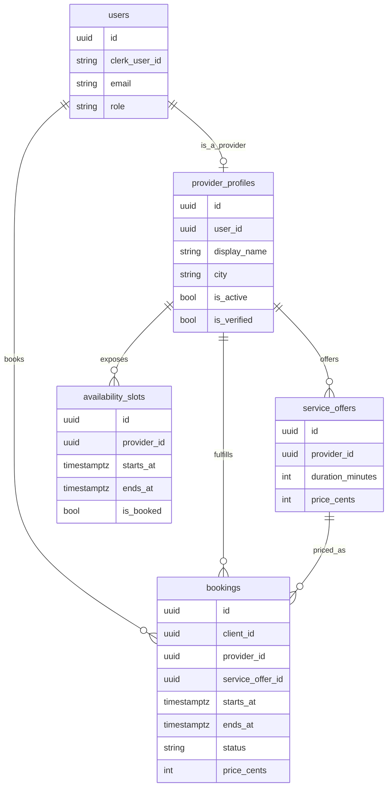
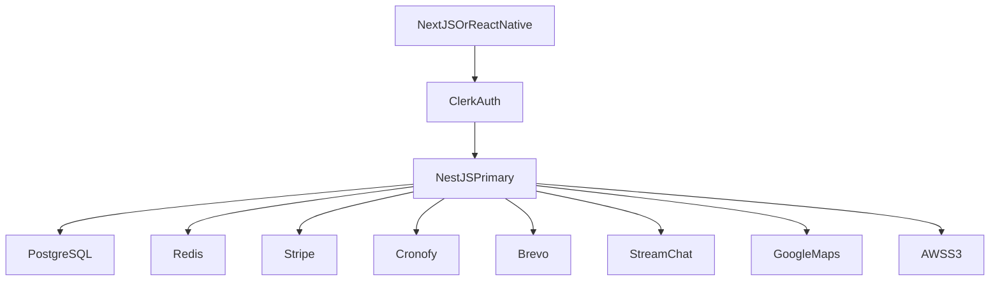

# Architecture — Phase 1

This document captures the state of the backend scaffold. See
[`../stack.md`](../stack.md) for the broader stack choices.

## Services in this repo

| Service | Path | Role | Default port |
|---------|------|------|--------------|
| `api` (NestJS + Fastify) | [`apps/api-nestjs`](../apps/api-nestjs) | Primary REST API (OpenAPI/Swagger) | 8000 |
| `postgres` | — | Primary relational store | 5432 |
| `redis` | — | Cache + async queue backend | 6379 |

The API runs TypeORM migrations on container startup, so the database schema
is created automatically when bringing the stack up against a fresh volume.

## NestJS module layout

```
apps/api-nestjs/src/
├── main.ts                    # Fastify bootstrap (helmet, CORS, ValidationPipe, Swagger)
├── app.module.ts              # Root module, imports Config/Database/Redis/Auth/...
├── config/                    # configLoader + Joi env validation schema
├── database/
│   ├── database.module.ts     # TypeORM forRootAsync (migrationsRun: true)
│   ├── data-source.ts         # CLI DataSource for typeorm migration:* scripts
│   ├── entities/              # User, ProviderProfile, ServiceOffer,
│   │                          # AvailabilitySlot, Booking
│   └── migrations/            # 1700000000000-init.ts (initial schema)
├── redis/                     # ioredis client + RedisService
├── auth/                      # ClerkAuthGuard + @CurrentClerkUser decorator
├── integrations/              # Stripe / Cronofy / Stream / Brevo services
└── modules/
    ├── health/                # /health liveness, /ready Terminus checks
    ├── users/                 # /thisUser, /me (upsert from Clerk subject)
    └── bookings/              # /bookings list + create scaffold
```

## Data model (Phase 1 baseline)



## Runtime flow



## Authentication (Phase 1)

- `ClerkAuthGuard` reads the `Authorization: Bearer …` header, decodes the JWT
  payload (without signature verification — Phase 1 stub mirroring the prior
  FastAPI behaviour), and attaches a `ClerkUser` to the request.
- `@CurrentClerkUser()` parameter decorator exposes that user inside controllers.
- Protected routes today: `GET /thisUser`, `GET /me`, `GET /bookings`,
  `POST /bookings`.
- Phase 2 swaps in JWKS verification once the Clerk instance URL is known.

## Integrations (Phase 1)

All integration services expose a `configured` flag driven by env vars and do
not perform business calls in Phase 1:

- `StripeService` — wraps the `stripe` SDK; bound at construction when
  `STRIPE_SECRET_KEY` is present.
- `CronofyService` — data-center-aware `baseUrl` helper.
- `StreamService` — credentials-only scaffold.
- `BrevoService` — exposes Brevo v3 base URL and the auth header set used by
  the future HTTP client.
- AWS S3 and Google Maps — keys are loaded into the typed config object;
  clients will be added when first used.

## Health checks

- `GET /health` — fast liveness probe, returns `{status: "ok"}` without
  touching backing services.
- `GET /ready` — Terminus-based readiness probe that pings PostgreSQL via
  TypeORM and runs `PING` against Redis.
