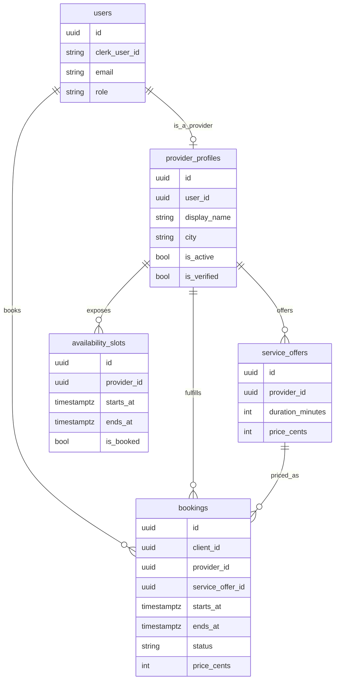
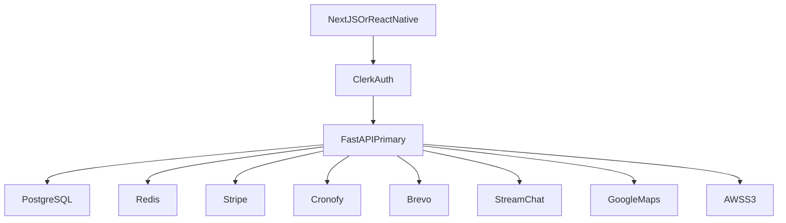

# Architecture — Phase 1

This document captures the state of the backend scaffold. See
[`../stack.md`](../stack.md) for the broader stack choices.

## Services in this repo

| Service | Path | Role | Default port |
|---------|------|------|--------------|
| `api` (FastAPI) | [`apps/api-fastapi`](../apps/api-fastapi) | Primary runnable REST API (OpenAPI/Swagger) | 8000 |
| `api-nestjs` | [`apps/api-nestjs`](../apps/api-nestjs) | Secondary scaffold (NestJS + Fastify) | 8001 |
| `postgres` | — | Primary relational store | 5432 |
| `redis` | — | Cache + async queue backend | 6379 |

Only `api`, `postgres`, and `redis` are started by the default Compose profile.
The NestJS service runs with `docker compose --profile nest up`.

## Data model (Phase 1 baseline)

## Runtime flow

## Authentication (Phase 1)

- FastAPI: `require_clerk_user` FastAPI dependency reads `Authorization: Bearer`,
  performs an unverified claims decode, and returns a `ClerkUser`. Full JWKS
  verification lands when the Clerk instance URL is known.
- NestJS: `ClerkAuthGuard` mirrors the same contract for Fastify requests.
- Protected example routes: `GET /me` (FastAPI), `POST /bookings` on both apps.

## Integrations (Phase 1)

All integrations expose a `configured` flag driven by env vars. They do not
perform business calls in Phase 1:

- Stripe — secret key is bound at import time.
- Cronofy — data-center-aware base URL helper.
- Stream Chat — credential-only scaffold.
- Brevo — transactional email client with HTTP factory.
- AWS S3 and Google Maps — keys are loaded from env, clients will be added
  when first used.
