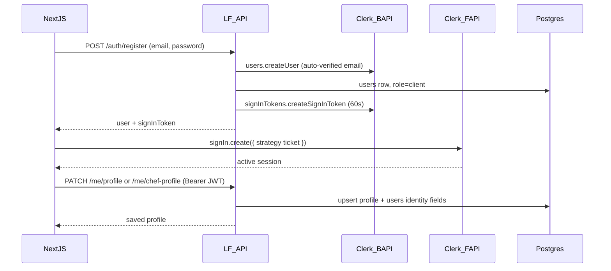
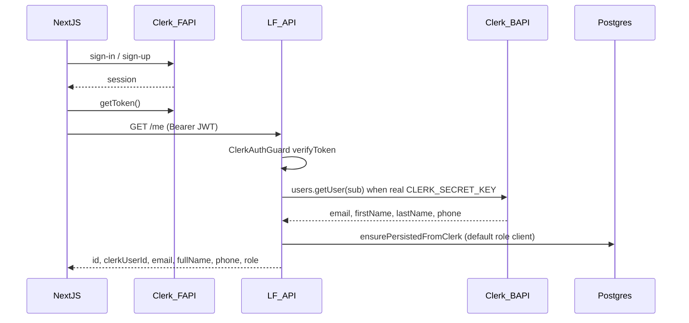

# Clerk integration contract (frontend ↔ backend)

## Responsibility split

| Layer                      | Owns                                                                                                                                         | Does not own                            |
| -------------------------- | -------------------------------------------------------------------------------------------------------------------------------------------- | --------------------------------------- |
| **Next.js frontend**       | Sign-**in**, session UI via `@clerk/nextjs` + Clerk FAPI; redeeming sign-up tickets                                                          | Postgres `users.role`, LF business data |
| **NestJS API (this repo)** | Sign-**up** (`POST /auth/register`), JWT verification, webhooks, `GET /me` upsert, onboarding profiles, admin provisioning, RBAC in Postgres | Password **login**, refresh, FAPI proxy |

Frontends **never** POST email/password to this API to _authenticate_. Registration is the one exception — `POST /auth/register` accepts a password to create the account, then hands back a sign-in ticket. After Clerk establishes a session, the client calls `getToken()` and sends `Authorization: Bearer <jwt>` on protected routes.

## Public sign-up (two forms)

`POST /auth/register` is the only unauthenticated write endpoint on the API. It is IP rate-limited (`REGISTER_THROTTLE_LIMIT`, default 5 per hour).



| Form               | Endpoint                  | Guard            | Notes                                                                                                                                                                |
| ------------------ | ------------------------- | ---------------- | -------------------------------------------------------------------------------------------------------------------------------------------------------------------- |
| 1 — credentials    | `POST /auth/register`     | none             | `email` + `password` only. Always creates `role: client`. Returns `{ user, signInToken, expiresInSeconds }`                                                          |
| 2 — client profile | `PATCH /me/profile`       | `ClerkAuthGuard` | Taste prefs, address, household, plus `firstName` / `lastName` / `phone`                                                                                             |
| Batch cooker       | `POST /chef-applications` | none             | The candidature form. Creates the account (`role: chef`, unverified, browse-only) and emails a sign-in link; never returns one. See _Chef onboarding_ in `AGENTS.md` |

**The route selects the role — never the request body.** `role` is absent from every DTO on this path, so a submitted `role` is rejected with `400 property role should not exist`. A sign-up form may show a client/chef choice, but it must map to the endpoint, not to a body field. `admin` is not reachable from any public route; promote via SQL or `PATCH /admin/users/:id/role`.

### `signInToken` handling

Single-use, 60s TTL (`CLERK_SIGN_IN_TOKEN_TTL_SECONDS`). Treat it as a credential: redeem immediately, never log it, never persist it, never put it in a URL or query string.

### Chef vetting

A candidature creates the chef profile with `is_active: false` and `is_verified: false`. `is_verified` is granted by approving the candidature (`POST /admin/chef-applications/:id/approve`); `PATCH /admin/chefs/:id/verification` refuses to verify a profile whose candidature is not approved, and to activate an unverified one. `PATCH /me/chef-profile` is update-only self-edit for verified chefs and accepts neither flag.

> **Not yet enforced:** chef listings, booking assignment, and any future `ChefGuard` **must** filter on `is_active && is_verified`, or unvetted candidates will appear in live booking flows.

### One account, two spaces

One account may hold a client profile and a chef profile at once. `GET /me` returns `spaces` (`client`, `chef`, or both), derived from the profiles held; `role` is the space to open first and authorises nothing besides `admin`. A signed-in account applies with `POST /me/chef-application`; a chef opens the client space with `PATCH /me/profile`. Nobody books their own chef page (`409 SAME_PERSON`).

## First sign-in sync (frontend required)

After every **sign-up** or **sign-in**, the frontend **must** call `GET /me` before relying on LF user data (routing, role checks, profile). This is the primary Clerk → Postgres sync path and works even when webhooks have not arrived yet.



### When to call

| Event                                 | Action                                                |
| ------------------------------------- | ----------------------------------------------------- |
| User completes sign-up                | Call `GET /me` once session is active                 |
| User completes sign-in                | Call `GET /me` once session is active                 |
| App loads with existing Clerk session | Call `GET /me` to refresh Postgres profile from Clerk |
| Before role-gated UI                  | Use `role` from the latest `/me` response             |

### Reference implementation (Next.js)

```typescript
import { useAuth } from "@clerk/nextjs";

const API_URL = process.env.NEXT_PUBLIC_API_URL!;

export async function syncLfUser(getToken: () => Promise<string | null>) {
  const token = await getToken();
  if (!token) {
    throw new Error("No Clerk session token");
  }

  const response = await fetch(`${API_URL}/me`, {
    headers: { Authorization: `Bearer ${token}` },
    cache: "no-store",
  });

  if (!response.ok) {
    throw new Error(`GET /me failed: ${response.status}`);
  }

  return response.json() as Promise<{
    id: string;
    clerkUserId: string;
    email: string;
    fullName: string | null;
    phone: string | null;
    role: "client" | "chef" | "admin";
  }>;
}

// Example: after sign-in or on protected layout mount
// const { getToken } = useAuth();
// const lfUser = await syncLfUser(getToken);
// route by lfUser.role — not Clerk publicMetadata alone
```

### What the API persists from Clerk

When a real `CLERK_SECRET_KEY` is configured, `GET /me` fetches the Clerk user via Backend API and upserts:

| Postgres `users` column | Clerk source                                        |
| ----------------------- | --------------------------------------------------- |
| `clerk_user_id`         | JWT `sub`                                           |
| `email`                 | primary email address                               |
| `full_name`             | `first_name` + `last_name`                          |
| `phone`                 | primary phone number (if set in Dashboard)          |
| `role`                  | defaults to `client` on create; never auto-promoted |

In local stub mode (`CLERK_SECRET_KEY=sk_test_placeholder`), only JWT `sub` (+ `email` when present in the token) is used.

Use returned `role` from `/me` for routing and feature flags—not Clerk `publicMetadata` alone.

## Admin user provisioning

Admins with `users.role = admin` (see bootstrap below) can:

| Method  | Path                    | Body                                                     | Notes                                                                                                    |
| ------- | ----------------------- | -------------------------------------------------------- | -------------------------------------------------------------------------------------------------------- |
| `POST`  | `/admin/users`          | `email`, `password?`, `firstName?`, `lastName?`, `role?` | Creates Clerk user via BAPI + Postgres row                                                               |
| `PATCH` | `/admin/users/:id/role` | `{ role: 'client' \| 'chef' \| 'admin' }`                | Re-syncs profile from Clerk BAPI, then updates Postgres role; optional Clerk `publicMetadata.role` merge |

**Requires a real `CLERK_SECRET_KEY`** (`sk_test_…` / `sk_live_…`). Returns `503` when `sk_test_placeholder` is set (local JWT-decode-only mode).

`PATCH /admin/users/:id/role` calls `ensurePersistedFromClerk` **before** changing role so email, full name, and phone from the Clerk Dashboard are in Postgres when elevating a user (e.g. to `admin`).

### BAPI email verification note

Clerk Backend API `users.createUser` **auto-verifies email addresses**. This applies to admin-driven provisioning, to public sign-up via `POST /auth/register` (since 2026-08-03, see below), and to `POST /chef-applications`. The candidature path compensates: its account has no password and the sign-in link goes only to the submitted inbox, so the address is proven before anyone can act on the account.

> **Consequence:** users created through either path skip the email-verification step your Clerk Dashboard enforces on the frontend FAPI flow. Nothing proves the address belongs to the registrant, so typo'd and disposable addresses reach `users`. The registration endpoint is IP rate-limited to blunt bulk abuse, but if you need real address ownership — before transactional booking mail or payments — the endpoint must additionally trigger a Clerk verification flow, or sign-up must move back to frontend FAPI.

### Password optional

- With `password`: passed to Clerk; `skipPasswordRequirement: false`
- Without `password`: `skipPasswordRequirement: true` (passwordless account; user completes sign-in via Clerk UI)

## First admin bootstrap

There is **no** self-serve “promote me to admin” endpoint.

1. User completes Clerk sign-up on the Next.js app (frontend calls `GET /me` → Postgres row with `role = client`).
2. One-time promotion — either:
   - SQL / Prisma Studio: `UPDATE users SET role = 'admin' WHERE email = 'you@example.com';`, or
   - An existing admin calls `PATCH /admin/users/:id/role` with `{ "role": "admin" }` (re-syncs Clerk profile first).
3. Further role changes via `PATCH /admin/users/:id/role`.

## Sync and consistency

| Direction        | Mechanism                                                                               |
| ---------------- | --------------------------------------------------------------------------------------- |
| Clerk → Postgres | `GET /me` (`ensurePersistedFromClerk`) + webhooks `POST /webhooks/clerk`                |
| Postgres → Clerk | `npm run db:sync:clerk` for placeholder ids; admin `POST /admin/users` for new accounts |
| RBAC             | **`users.role` in Postgres only** — guards read DB, not Clerk metadata                  |

See also: [`clerk-supabase-sync.md`](./clerk-supabase-sync.md).

## Local development

| Mode                         | JWT on API              | `GET /me` profile source     | Admin provisioning | Webhooks                              |
| ---------------------------- | ----------------------- | ---------------------------- | ------------------ | ------------------------------------- |
| Stub (`sk_test_placeholder`) | Decode-only stub tokens | JWT `sub` + optional `email` | `503`              | `503` without signing secret          |
| Real Clerk key               | `verifyToken`           | Clerk BAPI `users.getUser`   | Works              | Configure signing secret + tunnel URL |

Generate a local stub JWT (see [`AGENTS.md`](../../AGENTS.md)), call `GET /me`, then promote role in DB for admin route testing.

## Manual integration checklist (both sides)

Use this after unit tests pass, to validate the full flow before frontend E2E exists.

### A. Sign-up → DB sync (simulates frontend)

User signs up in Clerk (frontend or Clerk Dashboard).
Either: - Webhook user.created hits POST /webhooks/clerk, or - Frontend calls GET /me with Bearer JWT. - Verify in Postgres:
`sql
    SELECT id, clerk_user_id, email, role FROM users WHERE email = 'you@example.com';
    ` - Expected: row exists, role = 'client'.

### B. Sign-in → protected API

Frontend getToken() (or dev BAPI session token).
Call:
`bash
    curl -s http://localhost:8000/thisUser -H "Authorization: Bearer $TOKEN" | jq .
    curl -s http://localhost:8000/me -H "Authorization: Bearer $TOKEN" | jq .
    ` - Expected: 200 with user_id / clerkUserId.

### C. Bootstrap first admin

There is no self-promote endpoint. One-time in Postgres:

```sql
UPDATE users SET role = 'admin' WHERE email = 'you@example.com';
```

### D. Elevate another user to admin

```bash
curl -s -X PATCH "http://localhost:8000/admin/users/{postgres-uuid}/role" -H "Authorization: Bearer $ADMIN_TOKEN" -H "Content-Type: application/json" -d '{"role": "admin"}' | jq .
```

- Expected progression:
  - 401 → token invalid (fix Clerk key / JWT)
  - 403 → caller is not admin in Postgres
  - 200 → elevation works

### E. Admin creates a user

```bash
curl -s -X POST http://localhost:8000/admin/users -H "Authorization: Bearer $ADMIN_TOKEN" -H "Content-Type: application/json" -d '{
    "email": "newclient@example.com",
    "password": "StrongUniquePass123!",
    "firstName": "New",
    "lastName": "Client",
    "role": "client"
  }' | jq .
```

- Requires a real CLERK_SECRET_KEY (not sk_test_placeholder).

## Code map

| Piece                 | Location                                     |
| --------------------- | -------------------------------------------- |
| JWT guard             | `apps/src/auth/clerk-auth.guard.ts`          |
| Admin guard           | `apps/src/auth/admin.guard.ts`               |
| Clerk profile mapping | `apps/src/auth/clerk-user-payload.ts`        |
| Clerk BAPI client     | `apps/src/integrations/clerk.service.ts`     |
| Upsert + admin ops    | `apps/src/modules/users/users.service.ts`    |
| `GET /me`             | `apps/src/modules/users/users.controller.ts` |
| Admin routes          | `apps/src/modules/users/users.controller.ts` |
| Webhooks              | `apps/src/modules/clerk-webhooks/`           |
