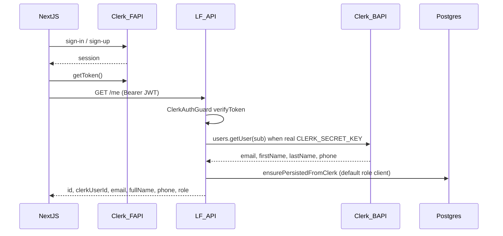

# Clerk integration contract (frontend ↔ backend)

## Responsibility split


| Layer                      | Owns                                                                               | Does not own                               |
| -------------------------- | ---------------------------------------------------------------------------------- | ------------------------------------------ |
| **Next.js frontend**       | Sign-up, sign-in, session UI via `@clerk/nextjs` + Clerk FAPI                      | Postgres `users.role`, LF business data    |
| **NestJS API (this repo)** | JWT verification, webhooks, `GET /me` upsert, admin provisioning, RBAC in Postgres | Password login/register routes, FAPI proxy |


Frontends **never** POST email/password to this API for authentication. After Clerk establishes a session, the client calls `getToken()` and sends `Authorization: Bearer <jwt>` on protected routes.

## First sign-in sync (frontend required)

After every **sign-up** or **sign-in**, the frontend **must** call `GET /me` before relying on LF user data (routing, role checks, profile). This is the primary Clerk → Postgres sync path and works even when webhooks have not arrived yet.



### When to call

| Event | Action |
| ----- | ------ |
| User completes sign-up | Call `GET /me` once session is active |
| User completes sign-in | Call `GET /me` once session is active |
| App loads with existing Clerk session | Call `GET /me` to refresh Postgres profile from Clerk |
| Before role-gated UI | Use `role` from the latest `/me` response |

### Reference implementation (Next.js)

```typescript
import { useAuth } from '@clerk/nextjs';

const API_URL = process.env.NEXT_PUBLIC_API_URL!;

export async function syncLfUser(getToken: () => Promise<string | null>) {
  const token = await getToken();
  if (!token) {
    throw new Error('No Clerk session token');
  }

  const response = await fetch(`${API_URL}/me`, {
    headers: { Authorization: `Bearer ${token}` },
    cache: 'no-store',
  });

  if (!response.ok) {
    throw new Error(`GET /me failed: ${response.status}`);
  }

  return response.json() as Promise<{
    id: string;
    clerkUserId: string;
    email: string;
    fullName: string | null;
    phone: string | null;
    role: 'client' | 'chef' | 'admin';
  }>;
}

// Example: after sign-in or on protected layout mount
// const { getToken } = useAuth();
// const lfUser = await syncLfUser(getToken);
// route by lfUser.role — not Clerk publicMetadata alone
```

### What the API persists from Clerk

When a real `CLERK_SECRET_KEY` is configured, `GET /me` fetches the Clerk user via Backend API and upserts:

| Postgres `users` column | Clerk source |
| ----------------------- | ------------ |
| `clerk_user_id` | JWT `sub` |
| `email` | primary email address |
| `full_name` | `first_name` + `last_name` |
| `phone` | primary phone number (if set in Dashboard) |
| `role` | defaults to `client` on create; never auto-promoted |

In local stub mode (`CLERK_SECRET_KEY=sk_test_placeholder`), only JWT `sub` (+ `email` when present in the token) is used.

Use returned `role` from `/me` for routing and feature flags—not Clerk `publicMetadata` alone.

## Admin user provisioning

Admins with `users.role = admin` (see bootstrap below) can:


| Method  | Path                    | Body                                                     | Notes                                                                   |
| ------- | ----------------------- | -------------------------------------------------------- | ----------------------------------------------------------------------- |
| `POST`  | `/admin/users`          | `email`, `password?`, `firstName?`, `lastName?`, `role?` | Creates Clerk user via BAPI + Postgres row                              |
| `PATCH` | `/admin/users/:id/role` | `{ role: 'client' \| 'chef' \| 'admin' }`                | Re-syncs profile from Clerk BAPI, then updates Postgres role; optional Clerk `publicMetadata.role` merge |


**Requires a real `CLERK_SECRET_KEY`** (`sk_test_…` / `sk_live_…`). Returns `503` when `sk_test_placeholder` is set (local JWT-decode-only mode).

`PATCH /admin/users/:id/role` calls `ensurePersistedFromClerk` **before** changing role so email, full name, and phone from the Clerk Dashboard are in Postgres when elevating a user (e.g. to `admin`).

### BAPI email verification note

Clerk Backend API `users.createUser` **auto-verifies email addresses**. This is acceptable for admin-driven provisioning but is **not** used for self-service sign-up (handled entirely on the frontend via Clerk FAPI with your Dashboard verification settings).

### Password optional

- With `password`: passed to Clerk; `skipPasswordRequirement: false`
- Without `password`: `skipPasswordRequirement: true` (passwordless account; user completes sign-in via Clerk UI)

## First admin bootstrap

There is **no** self-serve “promote me to admin” endpoint.

1. User completes Clerk sign-up on the Next.js app (frontend calls `GET /me` → Postgres row with `role = client`).
2. One-time promotion — either:
   - SQL / Prisma Studio: `UPDATE users SET role = 'admin' WHERE email = 'you@example.com';`, or
   - An existing admin calls `PATCH /admin/users/:id/role` with `{ "role": "admin" }` (re-syncs Clerk profile first).
3. Further role changes via `PATCH /admin/users/:id/role`.

## Sync and consistency


| Direction        | Mechanism                                                                               |
| ---------------- | --------------------------------------------------------------------------------------- |
| Clerk → Postgres | `GET /me` (`ensurePersistedFromClerk`) + webhooks `POST /webhooks/clerk`              |
| Postgres → Clerk | `npm run db:sync:clerk` for placeholder ids; admin `POST /admin/users` for new accounts |
| RBAC             | **`users.role` in Postgres only** — guards read DB, not Clerk metadata                |


See also: [`clerk-supabase-sync.md`](./clerk-supabase-sync.md).

## Local development


| Mode                         | JWT on API              | `GET /me` profile source     | Admin provisioning | Webhooks                              |
| ---------------------------- | ----------------------- | ---------------------------- | ------------------ | ------------------------------------- |
| Stub (`sk_test_placeholder`) | Decode-only stub tokens | JWT `sub` + optional `email` | `503`              | `503` without signing secret          |
| Real Clerk key               | `verifyToken`           | Clerk BAPI `users.getUser`   | Works              | Configure signing secret + tunnel URL |


Generate a local stub JWT (see [`AGENTS.md`](../../AGENTS.md)), call `GET /me`, then promote role in DB for admin route testing.

## Code map


| Piece                   | Location                                     |
| ----------------------- | -------------------------------------------- |
| JWT guard               | `apps/src/auth/clerk-auth.guard.ts`          |
| Admin guard             | `apps/src/auth/admin.guard.ts`               |
| Clerk profile mapping   | `apps/src/auth/clerk-user-payload.ts`        |
| Clerk BAPI client       | `apps/src/integrations/clerk.service.ts`     |
| Upsert + admin ops      | `apps/src/modules/users/users.service.ts`    |
| `GET /me`               | `apps/src/modules/users/users.controller.ts` |
| Admin routes            | `apps/src/modules/users/users.controller.ts` |
| Webhooks                | `apps/src/modules/clerk-webhooks/`           |

