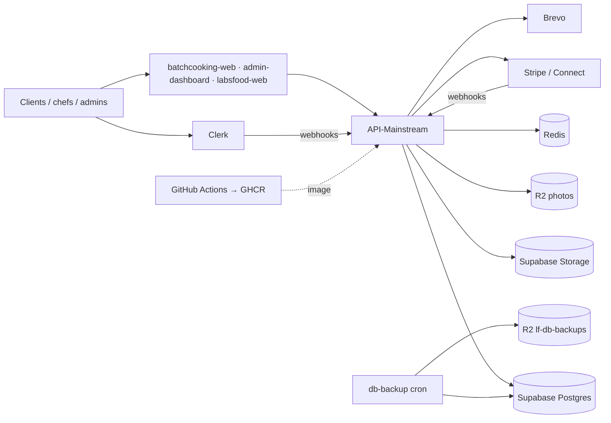

# PRA : plan de reprise d'activité de Lab's Food

> Version 1, rédigée le 18/11/2026, avant le lancement du 21/11/2026.
> À relire après chaque changement d'infrastructure, et au moins une fois par trimestre.
> Ce document ne contient aucun secret : les clés sont dans le gestionnaire de mots de passe.

Ce plan dit, pour chaque brique de la plateforme, **comment on voit qu'elle est tombée,
ce que ça casse, en combien de temps on doit revenir, et quoi faire, dans l'ordre**.
Il se lit en incident : allez directement à la fiche du service concerné (§5).

Sommaire :

1. [Rôles et contacts](#1-rôles-et-contacts)
2. [Inventaire et carte des dépendances](#2-inventaire-et-carte-des-dépendances)
3. [Objectifs RTO / RPO](#3-objectifs-rto--rpo)
4. [Procédure générale d'incident](#4-procédure-générale-dincident)
5. [Fiches de reprise par service](#5-fiches-de-reprise-par-service)
6. [Écarts constatés au 18/11/2026, à corriger](#6-écarts-constatés-au-18112026-à-corriger)
7. [Exercices et tests](#7-exercices-et-tests)
8. [Annexes : liens, commandes, modèle de journal](#8-annexes)

---

## 1. Rôles et contacts

| Rôle | Qui | Ce qu'il fait |
|---|---|---|
| **Responsable d'incident (RI)** | MajorD (fondateur, compte Railway `Danyjk`) | Décide, agit sur la prod, communique. Seule personne avec les accès admin à tout aujourd'hui. |
| **Suppléant** | *À désigner* | Doit pouvoir au minimum : faire un Rollback Railway, lire Sentry, poster un message aux clients. |
| **Support opérationnel** | Équipe Lab's Food (admin console) | Prévient le RI, répond aux clients et aux batch cookers, saisit les demandes URSSAF à la main si besoin. |
| **Fournisseurs** | Railway, Supabase, Clerk, Stripe, Brevo, Cloudflare, GitHub | Support via leur console (voir §8.1). |

**Risque n°1 du plan : une seule personne a les clés.** Tant qu'il n'y a pas de suppléant,
le RTO réel de tous les services est « le temps que MajorD soit joignable ». Voir §6.

Accès indispensables, à garder hors de l'ordinateur de travail (gestionnaire de mots de passe
avec accès d'urgence, plus une copie papier des codes de récupération 2FA) :

- comptes Railway, Supabase, Clerk, Stripe, Brevo, Cloudflare, GitHub (org `LabsFood`), Sentry, registrar du domaine `labsfood.fr` ;
- la **clé privée age** `lf-db-backup.key` (sans elle les sauvegardes de la base sont illisibles) ;
- `KYC_ENCRYPTION_KEY` de production (sans elle les dossiers URSSAF chiffrés sont perdus) ;
- les codes de récupération 2FA de chaque compte.

---

## 2. Inventaire et carte des dépendances

### 2.1 Services de production (état relevé sur Railway le 18/11/2026)

| Service | Où | Source / build | Domaine | Réplicas |
|---|---|---|---|---|
| **API** `API-Mainstream` | Railway, projet `LF-API-Backend`, env `production` | Image `ghcr.io/labsfood/lf-backend:sha-…` (aujourd'hui `sha-149e742`), poussée par GitHub Actions | `api-mainstream-production.up.railway.app` (pas de domaine perso) | 1 (europe-west4) |
| **Redis** | Railway, `LF-API-Backend` | Plugin Railway | interne | 1 |
| **db-backup** (cron) | Railway, `LF-API-Backend`, `production` | Repo `LF-BackEnd`, branche `develop`, `/ops/db-backup/Dockerfile` | aucun | cron `0 2 * * *` (quotidien, 03:00 Paris en hiver) |
| **batchcooking-web** | Railway, projet `LF-Frontend`, `production` | Repo, branche `main`, Railpack | `batchcooking.labsfood.fr`, `www.labsfood.fr`, `batch-beta-test.labsfood.fr` | 2 (us-west2 + europe-west4) |
| **admin-dashboard** | Railway, `LF-Frontend`, `production` | Repo, branche `main`, Railpack | `admin.labsfood.fr` | 2 (us-west2 + europe-west4) |
| **labsfood-web** | Railway, `LF-Frontend`, `production` | Repo `labsfood-web`, branche `main` | `app.labsfood.fr` | 1 |
| Develop / staging | `LF-API-Backend` env `develop` et `staging` (service `LF-BackEnd`), `LF-Frontend` env `develop` | Build Railway depuis `develop` | | |

Le projet Railway `hearty-rebirth` (backend, admin, batchcooking, Redis) n'est pas la prod :
à confirmer et supprimer s'il ne sert plus, pour ne pas s'y tromper en pleine panne.

### 2.2 Services externes

| Service | Rôle | Données qu'il détient |
|---|---|---|
| **Supabase Postgres** | Base unique de l'API (Prisma) | Toutes les données métier : utilisateurs, profils, plats, devis, réservations, paiements, factures, messages, audit |
| **Supabase Storage** | Buckets privés `labsfood-kyc` (pièces KYC des chefs, dossiers URSSAF), `labsfood-invoices` (factures PDF), messagerie (pièces jointes) | Fichiers. **Non sauvegardés aujourd'hui.** |
| **Cloudflare R2** | Bucket public des photos (plats, menus, profils) ; bucket privé `lf-db-backups` (sauvegardes chiffrées) | Photos ; dumps chiffrés |
| **Clerk** | Connexion, sessions, JWT | Comptes de connexion (le rôle et les données métier sont dans Postgres) |
| **Stripe + Connect** | Paiements CB, SEPA, comptes Express des chefs, commissions | Source de vérité des paiements |
| **Brevo** | E-mails transactionnels (24+ modèles) | Modèles d'e-mails, journaux d'envoi |
| **URSSAF** | Avance immédiate en mode `manual` : un admin saisit les demandes sur l'espace URSSAF de Lab's Food | Dossiers côté URSSAF |
| **GitHub + GHCR** | Code, CI, images Docker de l'API, workflow de déploiement prod | Code, images |
| **Sentry / PostHog** | Erreurs, moniteurs cron et uptime / analytics | Observabilité uniquement |
| **DNS `labsfood.fr`** | Domaines des fronts | *Registrar et hébergeur DNS à noter en §8.1* |

### 2.3 Qui dépend de qui



Lecture rapide : **si l'API ou Postgres tombe, tout le site est à l'arrêt** (les pages
s'affichent mais rien ne charge). Clerk tombé = plus personne ne se connecte. Les autres
pannes dégradent une fonction précise.

---

## 3. Objectifs RTO / RPO

- **RTO** (Recovery Time Objective) : durée maximale d'interruption acceptée.
- **RPO** (Recovery Point Objective) : quantité maximale de données qu'on accepte de perdre, en temps.

| Service | Criticité | RTO cible | RPO cible | RPO réel au 18/11 |
|---|---|---|---|---|
| API | Critique | 30 min | 0 (sans état) | 0 |
| Postgres (panne fournisseur) | Critique | 1 h (dépend de Supabase) | 0 | 0 |
| Postgres (données détruites / corrompues) | Critique | 4 h | **24 h** | 24 h (cron quotidien depuis le 18/11) + sauvegardes Supabase si offre payante |
| Supabase Storage | Haute | 4 h | 24 h | **aucune copie** (§6) |
| Clerk | Critique | dépend de Clerk | 0 | 0 (rejouable) |
| Stripe | Critique | dépend de Stripe | 0 | 0 (Stripe rejoue les webhooks 3 jours) |
| batchcooking-web, admin-dashboard | Haute | 30 min | 0 (sans état) | 0 |
| labsfood-web | Moyenne | 2 h | 0 | 0 |
| Redis | Basse (1 réplica API) | 1 h | sans objet (données jetables) | sans objet |
| Brevo | Moyenne | 4 h | e-mails perdus pendant la panne | idem |
| R2 photos | Moyenne | 4 h | 24 h | **aucune copie** |
| URSSAF | Moyenne | 1 jour ouvré | 0 (saisie manuelle) | 0 |
| CI / GHCR | Basse (ne bloque que les déploiements) | 1 jour | 0 | 0 |

---

## 4. Procédure générale d'incident

À suivre quelle que soit la panne. Ouvrir tout de suite un journal d'incident (modèle §8.4).

1. **Détecter.** Sources, par ordre de fiabilité :
   - alertes Sentry `[prod] Monitors` et `[prod] New, regressed or reappearing error` (e-mail) ;
   - Railway : déploiement `CRASHED` / `FAILED`, ou métriques à plat ;
   - signalement client, chef ou équipe ;
   - pages de statut des fournisseurs (§8.1).
2. **Qualifier (5 min).** Lancer les trois sondes (§8.2) : `/health`, `/ready`, page d'accueil.
   - `/health` KO → l'API (§5.1).
   - `/health` OK mais `/ready` KO → Postgres (§5.2).
   - les deux OK mais symptôme ciblé → service externe concerné.
   - Un déploiement ou un changement de variable dans l'heure qui précède ? **C'est presque
     toujours la cause : annuler d'abord, analyser ensuite.**
3. **Stopper l'aggravation.** Ne rien modifier d'autre en prod pendant la reprise. Une seule
   personne agit sur la prod à la fois.
4. **Communiquer** si l'interruption dépasse 15 min ou touche des paiements : message sur
   le site / réseaux, e-mail aux chefs ayant une prestation dans les 24 h. Rester factuel.
5. **Rétablir** en suivant la fiche du service.
6. **Vérifier** : sondes §8.2, un parcours réel (connexion, liste des plats, ouverture d'une
   réservation dans la console), Sentry calme 15 min.
7. **Clore et apprendre** sous 48 h : post-mortem court (cause, durée, données perdues,
   action pour que ça ne revienne pas), mis à jour dans ce document si besoin.

**Règle d'or issue de l'incident du 18/11/2026 :** ne jamais poser en prod une nouvelle
valeur de variable avant que l'image qui la comprend soit déployée. L'API valide ses
variables au démarrage (Joi) : une valeur inconnue = conteneur qui ne démarre pas.

---

## 5. Fiches de reprise par service

Chaque fiche : **Détection · Impact · RTO/RPO · Reprise · Qui**.

### 5.1 API (`API-Mainstream`)

**Détection**
- `GET /health` ne répond pas ou pas 200 ; Railway affiche le déploiement `CRASHED`
  (il relance seul un conteneur planté jusqu'à 10 fois, et refuse un déploiement dont
  `/health` ne répond pas en 300 s : l'ancien reste alors en ligne) ;
  logs Railway avec `ERROR` au démarrage (validation des variables, migration Prisma).
- Pic d'erreurs 5xx dans Sentry, moniteur `[prod]` sur le taux d'erreur API ou la p95.
- Pas d'uptime monitor Sentry sur l'API (domaine `*.railway.app` refusé, §6).

**Impact** : tout. Les fronts s'affichent mais aucune donnée, aucune connexion utile,
aucun paiement. Les webhooks Stripe et Clerk échouent et seront rejoués plus tard.
Les crons internes (relances, expirations d'offres, réservations impayées) ne tournent pas
et rattrapent au redémarrage.

**RTO 30 min · RPO 0.**

**Reprise.** Choisir le cas.

*A. Crash juste après un déploiement ou un changement de variable (cas le plus fréquent)*
1. Railway → `LF-API-Backend` → `production` → `API-Mainstream` → **Deployments**.
2. Sur le dernier déploiement `SUCCESS` connu bon → **⋯ → Rollback**. Le rollback
   redéploie l'image et la configuration de ce déploiement.
3. Si la cause est une variable : la remettre à sa valeur précédente (ou la supprimer) dans
   **Variables**, puis **Deploy** des changements stagés. Exemple 18/11 :
   `URSSAF_GATEWAY=manual` refusée par l'image v2.1.0 → retour à l'absence de variable.
4. Vérifier `/health` puis `/ready` (§8.2).

*B. Crash sans changement récent*
1. Lire les 200 dernières lignes de logs du déploiement (Railway → Logs, filtre `level:error`).
2. Si c'est la migration au démarrage (`prisma migrate deploy` échoue) : **ne pas** relancer en
   boucle. Vérifier que Postgres répond (§5.2). Si une migration est à moitié appliquée :
   `npx prisma migrate status` depuis un poste avec `SUPABASE_DB_MIGRATION_URL`, corriger,
   puis `npx prisma migrate resolve --rolled-back <migration>` ou `--applied`, selon le cas.
3. Si c'est une dépendance externe au démarrage (clé invalide, Supabase injoignable) :
   aller à la fiche du service concerné.
4. Sinon **Restart** du service. Si le crash revient, Rollback sur l'image précédente
   (cas A).

*C. Panne de la région ou de Railway* : voir §5.12.

*D. Il faut déployer un correctif alors que GitHub Actions est bloqué* : voir §5.11.

**Qui** : RI. Le suppléant peut faire le cas A (Rollback) sans autre connaissance.

---

### 5.2 Base de données (Supabase Postgres)

**Détection**
- `/ready` répond en erreur alors que `/health` est OK.
- Logs API : `P1001` (injoignable), `P1017`, `too many connections`, timeouts Prisma.
- Page de statut Supabase ; e-mails Supabase (quota, pause du projet).

**Impact** : tout le site est en panne fonctionnelle (même effet que l'API).

**RTO 1 h (panne fournisseur) / 4 h (restauration) · RPO 24 h cible.**

**Reprise.** Choisir le cas.

*A. Supabase indisponible (incident fournisseur)*
1. Confirmer sur la page de statut Supabase et le tableau de bord du projet.
2. Rien à restaurer : attendre le retour, communiquer (§4.4). Ne pas lancer de
   restauration, on perdrait des données pour rien.
3. Au retour : vérifier `/ready`, puis que les webhooks Stripe en échec sont rejoués
   (Stripe → Developers → Webhooks → événements en échec → **Resend** si besoin).

*B. Saturation de connexions ou projet en pause*
1. Supabase → Database → **Roles / Connections** : identifier qui consomme
   (`select usename, application_name, count(*) from pg_stat_activity group by 1,2`).
2. L'API doit passer par le **pooler de transaction** (port 6543, `pgbouncer=true`) ; seule la
   migration utilise le 5432. Vérifier `SUPABASE_DB_URL`.
3. Projet en pause / quota dépassé : relancer ou passer à l'offre supérieure dans Supabase.

*C. Données détruites ou corrompues (mauvaise migration, suppression, bug)*
1. **Arrêter l'écriture** : `API-Mainstream` → mettre à 0 réplica ou retirer le déploiement.
2. Faire immédiatement un dump de l'état actuel, même abîmé (preuve et retour arrière) :
   `pg_dump "$PROD_DB_URL" -Fc -f avant-restauration-$(date +%F-%H%M).dump`
3. Choisir la source de restauration la plus récente :
   - **Sauvegarde Supabase** (Database → Backups, ou PITR si activé) : la plus fraîche si
     l'offre le permet. Attention, elle restaure toute la base, schémas `auth` et `storage` compris.
   - **Sauvegarde chiffrée R2** (`lf-db-backups`) : procédure complète dans
     [`ops/db-backup/README.md`](../../ops/db-backup/README.md) (télécharger, déchiffrer avec la
     clé age, répéter sur une base jetable, puis `pg_restore --clean --if-exists
     --single-transaction -n public`).
4. Si seule une table est touchée : restaurer le dump dans une base jetable et recopier
   uniquement les lignes perdues, plutôt que d'écraser toute la prod.
5. Relancer l'API, vérifier les comptages (utilisateurs, réservations, paiements) par
   rapport au dernier état connu.
6. **Réconcilier avec Stripe** : tout paiement survenu entre la sauvegarde et l'incident
   existe chez Stripe mais plus en base. Stripe → Payments, filtrer sur la période, et
   rejouer les événements (`Resend` sur l'endpoint webhook) : l'API ignore ceux déjà
   traités (déduplication par `eventId`).
7. Réconcilier avec Clerk : `npm run db:backfill:clerk -- --all --yes` recrée les comptes
   Clerk absents de la base (voir [`docs/auth/clerk-supabase-sync.md`](../auth/clerk-supabase-sync.md)).
8. Prévenir les utilisateurs dont des actions ont été perdues (devis, messages) si on a
   pu les identifier.

*D. Perte du projet Supabase (compte, suppression)*
1. Créer un nouveau projet Supabase (région UE).
2. Restaurer la dernière sauvegarde R2 (cas C) dans ce projet.
3. Recréer les buckets Storage (§5.3) et réinjecter leur copie si elle existe.
4. Mettre à jour sur `API-Mainstream` : `SUPABASE_DB_URL`, `SUPABASE_DB_MIGRATION_URL`,
   `SUPABASE_URL`, `SUPABASE_SECRET_KEY`, `SUPABASE_PUBLISHABLE_KEY`, `SUPABASE_JWKS_URL`,
   et `BACKUP_DATABASE_URL` du cron (référence à la variable de l'API).
5. Redéployer, vérifier, réconcilier Stripe et Clerk (C.6, C.7).

**Qui** : RI uniquement (actions destructrices).

---

### 5.3 Fichiers (Supabase Storage : KYC, factures, messagerie)

**Détection** : erreurs 5xx sur les routes d'upload / téléchargement ; Sentry
(`supabase` dans la trace) ; un chef ne peut plus déposer de pièce, un client ne peut
plus télécharger sa facture.

**Impact**
- `labsfood-kyc` : plus d'onboarding chef ni de dépôt de dossier URSSAF. Perte = pièces
  d'identité à redemander, et **incident de données personnelles** (voir plus bas).
- `labsfood-invoices` : téléchargement de facture KO. Perte sans gravité : l'API redessine
  le PDF depuis l'instantané figé en base au prochain téléchargement.
- messagerie : pièces jointes inaccessibles ; les messages texte (en base) restent.

**RTO 4 h · RPO 24 h cible, aujourd'hui aucune copie.**

**Reprise**
1. Panne fournisseur : attendre, communiquer. Rien d'autre.
2. Bucket supprimé / fichiers perdus : recréer le bucket **privé**, même nom, aucune policy
   `anon` ni `authenticated` (voir [`docs/deploy/railway.md`](../deploy/railway.md) §2).
   - factures : rien à faire, elles se régénèrent ;
   - KYC : lister les chefs dont les documents manquent (table des documents, chemin de
     stockage) et leur demander un nouveau dépôt ; repasser les dossiers concernés en revue ;
   - messagerie : pièces jointes perdues, prévenir les participants si besoin.
3. **Bucket KYC rendu public ou fuite suspectée** : le repasser en privé immédiatement,
   puis `audit_log` (`action = 'document.read'`) pour mesurer l'exposition. Une fuite de
   pièces d'identité est une violation de données : notification **CNIL sous 72 h** et
   information des personnes concernées si le risque est élevé.

**Qui** : RI.

---

### 5.4 Redis

**Détection** : logs API `Redis` en erreur, Railway service Redis `CRASHED`.

**Impact** : avec **un seul réplica** de l'API, faible. Le service retombe sur le mode
en mémoire : limite de débit de la messagerie et diffusion WebSocket locales. Avec
plusieurs réplicas, un message posté sur l'un n'atteindrait pas un WebSocket tenu par l'autre.

**RTO 1 h · RPO sans objet** (données éphémères).

**Reprise**
1. Railway → Redis → **Restart**. Si le volume est corrompu, recréer le service Redis :
   les données n'ont aucune valeur durable.
2. Mettre à jour `REDIS_URL` sur l'API si l'adresse change, redéployer.
3. En attendant, si l'API plante à cause de Redis : retirer `REDIS_URL` (repli en mémoire
   prévu par le code) **et ne garder qu'un réplica**.

**Qui** : RI ou suppléant.

---

### 5.5 Authentification (Clerk)

**Détection** : plus personne ne se connecte, erreurs 401 en masse dans Sentry,
page de statut Clerk ; `/me` en erreur dans la console admin.

**Impact** : toute action connectée impossible (clients, chefs, admins). Les pages
publiques restent consultables.

**RTO : dépend de Clerk · RPO 0** (comptes chez Clerk ; rôles et données dans Postgres).

**Reprise**
1. Panne Clerk : rien à faire côté nous, communiquer.
2. Clé révoquée / mal configurée (`CLERK_SECRET_KEY`, clé publique des fronts) : remettre
   la bonne clé de l'instance **production** sur l'API et sur les deux fronts. Les clés
   `NEXT_PUBLIC_*` sont figées au build : il faut **redéployer** les fronts après changement.
3. Webhooks Clerk en échec pendant une panne de l'API : Clerk (Svix) les rejoue ; sinon
   Clerk → Webhooks → **Replay** des messages en échec. Filet de sécurité : la ligne
   `users` est créée à la première visite de `GET /me`, et `npm run db:backfill:clerk --
   --all --yes` rattrape tout.
4. Perte de l'instance Clerk : non récupérable rapidement (les identifiants vivent chez
   Clerk). Il faudrait une nouvelle instance, puis faire recréer les comptes ; la liaison
   se fait par `clerk_user_id`, à remapper par e-mail. Scénario à éviter : 2FA et accès
   de secours sur le compte Clerk.

**Qui** : RI.

---

### 5.6 Paiements (Stripe, Stripe Connect)

**Détection** : `/payments/*` en 503 (clé absente), échecs de paiement dans Sentry,
Stripe → Developers → **Webhooks** avec des livraisons en échec, page de statut Stripe.

**Impact** : plus de paiement CB / SEPA, plus d'onboarding chef, commissions non
prélevées, factures non émises. Le reste du site fonctionne.

**RTO : dépend de Stripe (côté nous 30 min) · RPO 0** : Stripe est la source de vérité
et rejoue les webhooks pendant 3 jours ; l'API déduplique par identifiant d'événement.

**Reprise**
1. Panne Stripe : communiquer, laisser les réservations en `pending` (elles ne sont
   annulées qu'à 72 h, job `bookings-unpaid-hold` ; une demande CGV V1 n'attend pas
   Stripe : son débit après la session, job `bookings-charge-after`, est tenté une fois,
   à relancer à la main si la panne tombe à ce moment). Si la panne dure, prolonger à la main
   dans la console les réservations concernées plutôt que de les laisser expirer.
2. Panne de **notre** API pendant que Stripe encaisse : au retour, Stripe → Webhooks →
   vérifier qu'il n'y a plus d'événements en échec ; sinon **Resend**. Contrôler dans la
   console que les paiements du créneau sont bien `succeeded`.
3. Secret de webhook faux (signatures refusées, 400 en série) : recopier
   `STRIPE_WEBHOOK_SECRET` (endpoint « Your account ») et `STRIPE_CONNECT_WEBHOOK_SECRET`
   (endpoint « Connected accounts ») depuis Stripe, redéployer, puis Resend.
4. Clé compromise : Stripe → API keys → **Roll key**, mettre la nouvelle sur l'API,
   redéployer. Faire de même pour les secrets webhooks si besoin.
5. Commission non prélevée : les échecs sont rejoués (`PAYMENTS_COMMISSION_DEBIT_MAX_ATTEMPTS`) ;
   au-delà, reprendre à la main depuis la console (Transactions).

**Qui** : RI. Remboursements et litiges : RI depuis le dashboard Stripe.

---

### 5.7 E-mails (Brevo)

**Détection** : Sentry (erreurs `brevo` loguées par l'API), Brevo → Transactional →
Logs (bounces, blocages), utilisateurs qui ne reçoivent pas de lien.

**Impact** : pas de mails de confirmation, de relance, de nouveau message, de résultat
de candidature. **Un e-mail qui échoue n'est pas réessayé** : il est perdu. Le plus
grave : `BREVO_TPL_APPLICATION_RECEIVED` porte le seul lien de connexion d'un nouveau chef.

**RTO 4 h · RPO : les e-mails émis pendant la panne sont perdus.**

**Reprise**
1. Panne Brevo ou compte suspendu (quota, réputation) : vérifier le compte Brevo, le
   domaine expéditeur (SPF/DKIM) et le quota.
2. Clé invalide : nouvelle clé API Brevo → `BREVO_API_KEY` → redéployer.
3. **Rattrapage** après la panne :
   - candidatures chef reçues pendant la panne : renvoyer le lien depuis la console
     (renvoi de lien de connexion, `BREVO_TPL_SIGN_IN_LINK`) ;
   - réservations et devis : la console montre l'état à jour, prévenir les personnes
     concernées à la main si une action de leur part est attendue ;
   - messages non lus : le job `MessagingNotifierCron` ne renvoie pas ce qui a échoué.
4. Plan B si Brevo est durablement HS : tout fournisseur SMTP/API transactionnel, mais il
   faut porter les 24+ modèles, ce n'est pas un changement rapide.

**Qui** : RI ; rattrapage par l'équipe support.

---

### 5.8 Photos (Cloudflare R2)

**Détection** : images cassées sur le site, routes photos en `503 PHOTOS_UNAVAILABLE`
(variables R2 manquantes), page de statut Cloudflare.

**Impact** : visuel ; on peut encore réserver. Upload de nouvelles photos impossible.

**RTO 4 h · RPO aujourd'hui aucune copie.**

**Reprise**
1. Panne Cloudflare : attendre.
2. Variables manquantes / jeton révoqué : nouveau jeton R2 (lecture-écriture sur ce bucket
   seulement), mettre à jour les 5 variables `R2_*`, redéployer.
3. Domaine public cassé : vérifier `R2_PUBLIC_BASE_URL` et le domaine du bucket.
4. Objets supprimés : sans copie, les chefs doivent re-téléverser. Voir §6.

**Qui** : RI.

---

### 5.9 Fronts (`batchcooking-web`, `admin-dashboard`, `labsfood-web`)

**Détection** : moniteurs uptime Sentry `[prod] Monitors` (site, admin), déploiement
Railway `CRASHED`/`FAILED`, page blanche ou erreur 500.

**Impact**
- `batchcooking-web` (`batchcooking.labsfood.fr` **et `www.labsfood.fr`**) : vitrine et
  espace client/chef, donc tout le parcours de réservation.
- `admin-dashboard` (`admin.labsfood.fr`) : l'équipe ne peut plus piloter (réservations,
  saisies URSSAF, modération). Les clients ne sont pas touchés.
- `labsfood-web` (`app.labsfood.fr`) : impact limité.

**RTO 30 min · RPO 0** (aucun état).

**Reprise**
1. Railway → `LF-Frontend` → `production` → service → **Deployments** → **Rollback** sur
   le dernier déploiement bon. Les fronts se construisent depuis la branche `main` par
   Railway (Railpack) : **ils ne dépendent pas de GitHub Actions**.
2. Si un seul des deux réplicas (us-west2 / europe-west4) est en panne : Railway route
   vers l'autre ; redémarrer le réplica fautif.
3. Changement de variable `NEXT_PUBLIC_*` ou `API_PROXY_TARGET` : elles sont figées **au
   build**, donc changer la variable puis **redéployer** (pas seulement redémarrer).
4. Domaine perso KO : Railway → Settings → Networking → état du domaine et du certificat
   (« Retry certificate »), puis enregistrement DNS chez l'hébergeur DNS.
5. Contournement si un domaine perso reste KO : l'URL `*.up.railway.app` du service
   fonctionne (sauf si Clerk refuse l'origine : la connexion n'y marchera pas).

**Qui** : RI ou suppléant (Rollback).

---

### 5.10 Avance immédiate URSSAF (mode `manual`, espace URSSAF)

**Détection** : impossible de saisir une demande sur l'espace URSSAF de Lab's Food, refus en série,
ou dossiers clients illisibles dans la console (erreur de déchiffrement).

**Impact** : les clients ne bénéficient pas de l'avance immédiate tant que la demande
n'est pas saisie. Le paiement CB reste possible.

**RTO 1 jour ouvré · RPO 0** : les dossiers sont en base (chiffrés) et les pièces dans
`labsfood-kyc`.

**Reprise**
1. Espace URSSAF indisponible : noter les demandes en attente (console) et les saisir au
   retour ; contacter l'URSSAF si ça dure plus d'un jour ouvré. Prévenir les clients concernés
   du délai.
2. Erreur de déchiffrement des dossiers : `KYC_ENCRYPTION_KEY` a changé ou manque.
   **Remettre la clé d'origine** (gestionnaire de mots de passe). Ne jamais générer une
   nouvelle clé : les dossiers existants deviendraient illisibles.
3. API qui refuse de démarrer à cause de `URSSAF_GATEWAY` : §5.1 cas A et la règle d'or (§4).
4. Repli : `URSSAF_GATEWAY=disabled` coupe l'avance immédiate proprement (paiement standard
   seulement), sur une image qui accepte cette valeur.

**Qui** : RI pour la configuration ; équipe support pour les saisies.

---

### 5.11 GitHub, GitHub Actions et GHCR (chaîne de déploiement de l'API)

**Détection** : jobs Actions refusés ou en file sans fin (ex. depuis le 17/11/2026 :
quota gratuit de minutes épuisé), image GHCR introuvable, workflow `Deploy production` bloqué.

**Impact** : **la prod continue de tourner**, mais on ne peut plus livrer de correctif à
l'API par le circuit normal (CI → image GHCR → `deploy-production.yml`). Les services de
develop qui attendent la CI sautent leurs déploiements. Les fronts ne sont pas touchés
(build Railway).

**RTO 1 jour (livraison normale) ; un correctif urgent doit passer en < 1 h par le circuit
de secours ci-dessous · RPO 0.**

**Reprise : circuit de secours pour déployer l'API sans Actions** (deux options)

*Option 1, image construite sur un poste et poussée à la main sur GHCR* (garde le même
mode de déploiement que la prod) :
```bash
git checkout <commit à livrer sur main>
SHA=$(git rev-parse --short HEAD)
echo "$GHCR_TOKEN" | docker login ghcr.io -u <login> --password-stdin   # PAT write:packages
docker build -f apps/Dockerfile -t ghcr.io/labsfood/lf-backend:sha-$SHA .
docker run --rm ghcr.io/labsfood/lf-backend:sha-$SHA node -e "1"        # l'image se lance
docker push ghcr.io/labsfood/lf-backend:sha-$SHA
```
Puis Railway → `API-Mainstream` → Settings → **Source image** →
`ghcr.io/labsfood/lf-backend:sha-$SHA` → Deploy. Vérifier §8.2.
Ce chemin saute les tests et le scan de la CI : réservé à l'urgence, lancer
`npm run lint && npm test` en local avant.

*Option 2, faire construire Railway depuis le Dockerfile* : passer temporairement la source
d'`API-Mainstream` sur le repo `LabsFood/LF-BackEnd`, branche `main`, Dockerfile
`/apps/Dockerfile`, health check `/health`. Plus simple, mais change la nature du service :
noter l'image d'origine pour revenir à la source GHCR une fois Actions rétabli.

Autres actions :
- Quota Actions épuisé : passer l'organisation sur une offre payante ou fixer une limite de
  dépense, ou attendre le renouvellement du cycle mensuel.
- Perte du dépôt GitHub : tout clone local à jour (poste du RI, sessions) suffit à le
  repousser dans un nouveau dépôt. Garder un miroir (voir §6).

**Qui** : RI.

---

### 5.12 Railway (plateforme ou projet entier)

**Détection** : page de statut Railway, tous les services KO en même temps, console
Railway inaccessible.

**Impact** : tout (API, fronts, Redis, cron de sauvegarde). Les données restent intactes
(Supabase, R2, Stripe, Clerk sont ailleurs).

**RTO : dépend de Railway ; plan de repli ≈ 1 journée · RPO 0.**

**Reprise**
1. Incident Railway court : attendre, communiquer.
2. Panne d'une seule région : l'API (1 réplica en europe-west4) est touchée ; Railway →
   service → Settings → **Regions** : passer le réplica dans une autre région, redéployer.
   Les fronts ont déjà deux régions.
3. Panne longue ou perte du compte (plan de repli, à n'engager qu'au-delà de quelques heures) :
   - redéployer l'image API GHCR sur un autre hébergeur de conteneurs (Fly.io, Render,
     Scaleway…) avec les mêmes variables (export préalable : voir §6) ;
   - les fronts sont des Next.js `output: 'standalone'` avec un `Dockerfile` : même chose ;
   - basculer les enregistrements DNS `batchcooking`, `www`, `admin`, `app` vers le nouvel
     hébergeur ; mettre à jour `API_PROXY_TARGET` / `NEXT_PUBLIC_API_URL` des fronts
     (puis rebuild), les URL de webhooks Stripe et Clerk, `CORS_ORIGINS` si besoin.
   - recréer le cron de sauvegarde ailleurs (n'importe quel ordonnanceur qui lance l'image
     `ops/db-backup`).

**Qui** : RI.

---

### 5.13 Sauvegarde de la base (`db-backup`) elle-même

**Détection** : déploiement du cron en `FAILED` dans Railway ; pas de nouveau fichier dans
`lf-db-backups` à la date attendue. Aujourd'hui, **aucune alerte** n'existe (§6).

**Impact** : aucun immédiat, mais le RPO de la base se dégrade à chaque run manqué.

**Reprise**
1. Lire les logs du run en échec (variable manquante, dump < 10 kB, upload refusé).
2. Corriger, puis Railway → `db-backup` → **Deploy** pour lancer un run à la main.
3. Vérifier la présence du fichier :
   `aws s3 ls s3://lf-db-backups/lf-api/ --endpoint-url https://<account>.eu.r2.cloudflarestorage.com`

**Qui** : RI.

---

### 5.14 Domaine et DNS (`labsfood.fr`)

**Détection** : tous les sous-domaines KO en même temps, erreurs DNS (`NXDOMAIN`),
e-mails Brevo rejetés (SPF/DKIM introuvables).

**Impact** : site, console et e-mails inaccessibles alors que tout tourne.

**RTO 2 h (hors propagation DNS) · RPO 0.**

**Reprise**
1. Vérifier l'expiration du domaine chez le registrar (activer le renouvellement auto).
2. Vérifier la zone DNS : CNAME de `batchcooking`, `www`, `admin`, `app` vers Railway,
   enregistrements Brevo (SPF, DKIM, DMARC), Clerk (si domaine perso Clerk).
3. Garder un export de la zone DNS (§6) pour la recréer à l'identique.

**Qui** : RI.

---

### 5.15 Fuite ou compromission d'un secret

**Détection** : alerte GitHub secret scanning, activité inconnue dans un tableau de bord
(Stripe, Clerk, Supabase), clé vue dans un log ou un commit.

**Impact** : variable selon la clé ; les plus graves : `SUPABASE_SECRET_KEY` et les URL de
base (accès à toutes les données), `STRIPE_SECRET_KEY`, `CLERK_SECRET_KEY`, `KYC_ENCRYPTION_KEY`.

**Reprise**
1. Révoquer / régénérer la clé chez le fournisseur.
2. Mettre la nouvelle valeur sur Railway (API et, selon la clé, fronts ou cron).
3. Redéployer. Vérifier.
4. Mot de passe Postgres : le changer dans Supabase, puis `SUPABASE_DB_URL`,
   `SUPABASE_DB_MIGRATION_URL` (le cron s'y réfère).
5. `KYC_ENCRYPTION_KEY` : **ne pas la régénérer sans re-chiffrer** les dossiers existants
   (script à écrire le jour où c'est nécessaire : déchiffrer avec l'ancienne, chiffrer avec la
   nouvelle, dans une transaction).
6. Évaluer l'accès aux données personnelles : notification CNIL sous 72 h si fuite avérée.

**Qui** : RI.

---

### 5.16 Observabilité (Sentry, PostHog)

**Impact** : on perd la détection, pas le service. Aucune action urgente : surveiller
manuellement (logs Railway, sondes §8.2) jusqu'au retour.

---

## 6. Écarts constatés au 18/11/2026, à corriger

Classés par urgence. Aucun n'a été modifié en production en rédigeant ce plan.

| # | Écart | Risque | Action proposée | Avant le 21/11 ? |
|---|---|---|---|---|
| 1 | ~~Le cron `db-backup` était réglé sur `0 2 5 * *` (mensuel)~~ | RPO de la base jusqu'à ~1 mois | **Corrigé le 18/11/2026** : `0 2 * * *` | Fait |
| 2 | Restauration **jamais testée** de bout en bout | On découvre le problème le jour J | Faire l'exercice §7.1 une fois, sur une base jetable | **Oui** |
| 3 | Les buckets **Supabase Storage** (KYC, factures, messagerie) et **R2 photos** ne sont pas sauvegardés ; les sauvegardes Supabase ne couvrent pas les fichiers | Perte des pièces KYC, des photos | Ajouter au cron une copie (`rclone sync`) vers un bucket R2 privé distinct, chiffrée pour le KYC | Dès que possible |
| 4 | Offre Supabase / PITR **non vérifiée** | RPO réel inconnu | Supabase → Database → Backups : noter l'offre, la rétention, PITR oui/non dans ce document | **Oui** |
| 5 | **Un seul responsable** avec tous les accès | RTO = disponibilité d'une personne | Désigner un suppléant, accès d'urgence au gestionnaire de mots de passe, rôle Railway membre | Oui si possible |
| 6 | Pas d'**alerte** si la sauvegarde échoue | Échecs silencieux | Moniteur cron Sentry (check-in en fin de `backup.sh`) ou alerte e-mail Railway | Bientôt |
| 7 | Pas de **domaine perso** sur l'API, donc pas d'uptime monitor (Sentry refuse `*.railway.app`) | Panne API détectée par les utilisateurs | Domaine `api.labsfood.fr` (ou `lf-api.labsfood.fr`, déjà valeur par défaut de `API_PROXY_TARGET` dans la console) + moniteur uptime sur `/health` | Bientôt |
| 8 | ~~`API-Mainstream` n'avait ni health check ni politique de redémarrage~~ | Un conteneur planté n'était pas relancé, un mauvais déploiement passait sans contrôle | **Corrigé le 18/11/2026** : health check `/health` (300 s), redémarrage *On failure* (10 essais) | Fait |
| 9 | CI GitHub Actions bloquée (quota) | Plus de livraison normale de l'API | Limite de dépense GitHub, ou circuit de secours §5.11 | Avant la promotion `develop` → `main` |
| 10 | E-mails Brevo **non réessayés** | Liens de connexion chef perdus | File de reprise ou relance des envois en échec | Après le lancement |
| 11 | Pas d'export des **variables Railway** et de la **zone DNS** hors Railway | Reconstruction lente si perte de compte | Export chiffré dans le gestionnaire de mots de passe après chaque changement | Bientôt |
| 12 | Projet Railway `hearty-rebirth` d'origine inconnue | Confusion pendant un incident | Confirmer qu'il ne sert plus, le supprimer | Après le lancement |

---

## 7. Exercices et tests

| Exercice | Fréquence | Durée |
|---|---|---|
| 7.1 Restaurer la dernière sauvegarde R2 dans une base jetable et comparer les comptages | Mensuel, et après tout changement du cron | 30 min |
| 7.2 Rollback Railway de l'API sur l'image précédente, en develop | Trimestriel, et à chaque nouveau suppléant | 10 min |
| 7.3 Déploiement de secours de l'API sans GitHub Actions (§5.11, option 1) en develop | Semestriel | 30 min |
| 7.4 Revue de ce document : services, variables, contacts | Trimestriel | 30 min |

### 7.1 Exercice de restauration (pas à pas)

```bash
# 1. Dernière sauvegarde
aws s3 ls s3://lf-db-backups/lf-api/ --endpoint-url https://<account>.eu.r2.cloudflarestorage.com | tail -1
aws s3 cp s3://lf-db-backups/lf-api/<stamp>.dump.age . --endpoint-url https://<account>.eu.r2.cloudflarestorage.com
# 2. Déchiffrer (clé privée depuis le gestionnaire de mots de passe)
age --decrypt -i lf-db-backup.key -o restore.dump <stamp>.dump.age
# 3. Base jetable
docker run -d --name lf-restore -p 5433:5432 -e POSTGRES_PASSWORD=x postgres:17
pg_restore --no-owner --no-privileges -n public -d postgresql://postgres:x@localhost:5433/postgres restore.dump
# 4. Comptages à noter dans le journal
psql postgresql://postgres:x@localhost:5433/postgres -c "select
  (select count(*) from users) users,
  (select count(*) from bookings) bookings,
  (select count(*) from _prisma_migrations) migrations;"
# 5. Nettoyer : supprimer le conteneur et les fichiers déchiffrés
docker rm -f lf-restore && rm -f restore.dump <stamp>.dump.age
```

Noter la date, la durée, l'âge de la sauvegarde et les comptages. Un écart inexpliqué
avec la prod est un incident à traiter.

---

## 8. Annexes

### 8.1 Consoles et pages de statut

| Service | Console | Statut |
|---|---|---|
| Railway | railway.com → workspace *Lab's Food* | status.railway.com |
| Supabase | supabase.com/dashboard | status.supabase.com |
| Clerk | dashboard.clerk.com | status.clerk.com |
| Stripe | dashboard.stripe.com | status.stripe.com |
| Brevo | app.brevo.com | status.brevo.com |
| Cloudflare (R2) | dash.cloudflare.com | cloudflarestatus.com |
| GitHub | github.com/LabsFood | githubstatus.com |
| Sentry (UE) | sentry.io | status.sentry.io |
| URSSAF | *à compléter : espace de saisie + contact support* | |
| Registrar / DNS `labsfood.fr` | *à compléter* | |

### 8.2 Sondes rapides

```bash
API=https://api-mainstream-production.up.railway.app
curl -s -o /dev/null -w "health %{http_code}\n" $API/health   # API vivante
curl -s -o /dev/null -w "ready  %{http_code}\n" $API/ready    # + base joignable
for u in https://batchcooking.labsfood.fr https://www.labsfood.fr https://admin.labsfood.fr https://app.labsfood.fr; do
  curl -s -o /dev/null -w "$u %{http_code}\n" $u
done
```

### 8.3 Où sont les procédures détaillées

| Sujet | Document |
|---|---|
| Déploiement, variables, crons internes, logs, Sentry | [`docs/deploy/railway.md`](../deploy/railway.md) |
| Sauvegarde et restauration de la base | [`ops/db-backup/README.md`](../../ops/db-backup/README.md) |
| URL de connexion Supabase (pooler / direct) | [`docs/database-connection.md`](../database-connection.md) |
| Synchronisation Clerk → Postgres, backfill | [`docs/auth/clerk-supabase-sync.md`](../auth/clerk-supabase-sync.md) |
| Webhooks et événements Stripe | [`docs/payments/stripe-payments-contract.md`](../payments/stripe-payments-contract.md) |
| Mode manuel URSSAF | [`docs/payments/urssaf-manual-mode-testbook.md`](../payments/urssaf-manual-mode-testbook.md) |

### 8.4 Modèle de journal d'incident

```markdown
## Incident AAAA-MM-JJ : <titre court>

- Détecté à : HH:MM (heure de Paris), par : <alerte / personne>
- Service(s) : <API / base / …>   Gravité : critique | haute | moyenne
- Dernier changement avant l'incident : <déploiement, variable, aucun>

### Chronologie
- HH:MM  constat …
- HH:MM  action …
- HH:MM  service rétabli

### Bilan
- Durée d'interruption : …        Données perdues : …
- Utilisateurs touchés / prévenus : …
- Cause : …
- Action pour que ça ne se reproduise pas : … (responsable, échéance)
```

**Exemple réel, 18/11/2026** : à 03:39 UTC, `URSSAF_GATEWAY=manual` posée sur
`API-Mainstream` alors que l'image en prod (v2.1.0) n'accepte que `disabled` → conteneur
qui refuse de démarrer → API en panne jusqu'au retour arrière (variable retirée,
redéploiement de `sha-149e742` à 03:50 UTC). Action : règle d'or §4.
