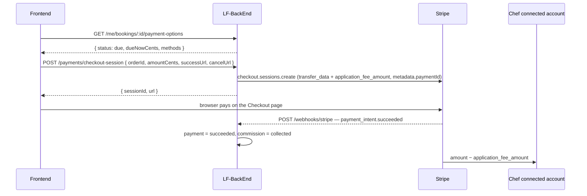
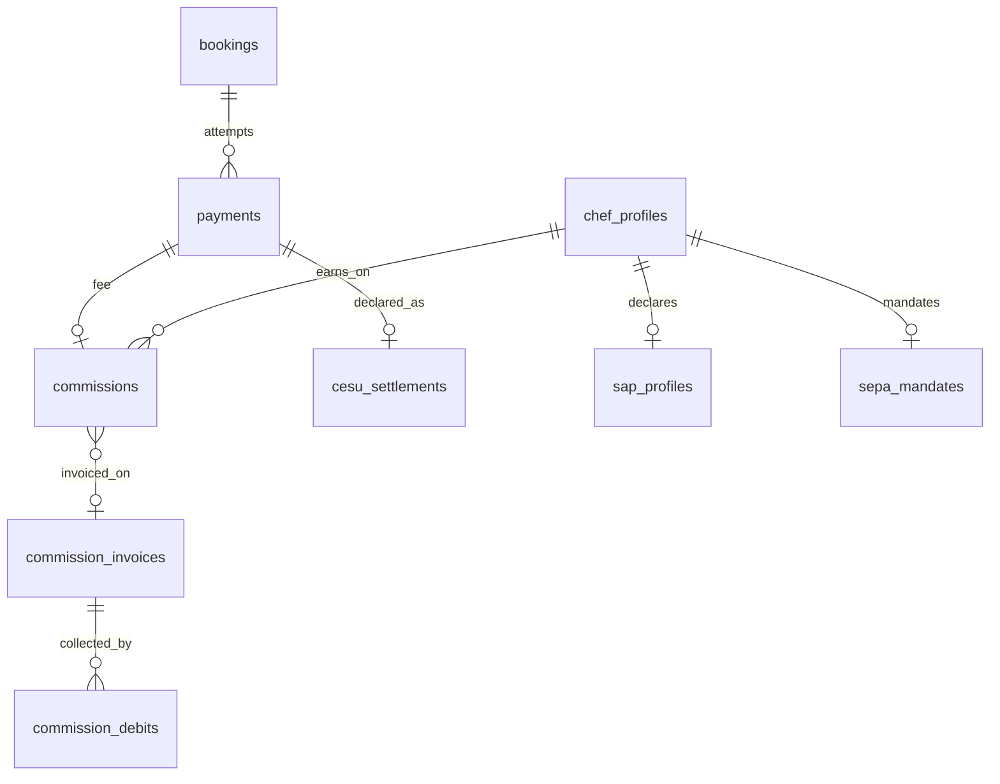

# Stripe payments — integration contract

How money moves through LF-BackEnd: paying a prestation (card, CESU, URSSAF immediate
advance), the platform commission, chef Stripe Connect onboarding, the commission
direct-debit mandate, and the "service à la personne" (SAP) fiscal data.

Companion documents: [`../auth/clerk-integration-contract.md`](../auth/clerk-integration-contract.md)
(who the caller is), [`../evolution/payments-stripe-cb-evolution.md`](../evolution/payments-stripe-cb-evolution.md)
(what changed and why), _Paying a prestation (FLOW-03)_ in [`../../AGENTS.md`](../../AGENTS.md)
(every payment route and rule), `SPEC-BACKEND.md` §4.3 (product intent; not in this repo since
`559c4d6`, see `git show 559c4d6^:docs/SPEC-BACKEND.md`).

## 1. Model in one paragraph

A prestation accepted from an offer is created `confirmed` and paid **after** it took place;
one booked through `POST /me/bookings` (or `/chef/bookings`, `/admin/bookings`) is created
`pending` and confirmed by its payment (§3 _Booking creation_). A card payment is a **Stripe
Connect destination charge**: the client is charged on the **platform** account; Stripe forwards the amount to the chef's
**connected account** minus `application_fee_amount`, which the platform keeps as its
commission. The commission is therefore collected atomically with the payment — there is
no second debit, and no payout job to run. The backend never sees card details: it hands
the frontend a Stripe Checkout `url` (or a `client_secret`), and a payment only counts as
paid when the `payment_intent.succeeded` webhook arrives.



## 2. Prerequisites per role

| Actor | Must have | How |
|-------|-----------|-----|
| Client | Clerk session, a booking they own that is due | Accepting an offer (`POST /me/quotes/:id/offers/:offerId/accept`), or booking (`POST /me/bookings`, or a batch cooker or admin booking for them) |
| Chef | Verified chef profile | Approved candidature (FLOW-01) |
| Chef | Connect account with `chargesEnabled` **and** `payoutsEnabled` | `POST /me/chef-profile/stripe-connect/link`, then Stripe hosted onboarding |
| Platform | `STRIPE_SECRET_KEY`, `STRIPE_WEBHOOK_SECRET` (+ `STRIPE_CONNECT_WEBHOOK_SECRET` when deployed) | see §6 |

A booking whose chef has not finished onboarding cannot be paid by card — the card
routes answer `409`, and `GET /me/bookings/:id/payment-options` leaves the card out.
Surface the chef's onboarding state in the chef app before a client ever reaches checkout.

**When a booking is due** (`payment-rules.ts`, the single rule): a `confirmed` booking once
`endsAt` has passed (`409 BOOKING_NOT_DUE` before), a `pending` one at once (paying confirms
it), a `cancelled` one never (`409 BOOKING_CANCELLED`).

## 3. Endpoints

All routes below require a Clerk bearer token unless stated otherwise. Amounts are
integers in **minor units** (cents) and currencies are ISO 4217.

### Client — what can be paid, and how

`GET /me/bookings/:id/payment-options` gives the state (`not-due`, `due`, `processing`,
`paid`, `failed`), the amounts, and the methods this client can use with this batch
cooker. A method the batch cooker does not take is left out; `dueNowCents` is computed
here, never in the browser. Poll it after a payment until `status` is `paid`.

### Client — pay by card

| Method | Path | Auth |
|--------|------|------|
| `POST` | `/payments/checkout-session` | Clerk (booking owner) |
| `POST` | `/payments/intent` | Clerk (booking owner) — for an embedded Stripe.js form |

```jsonc
// POST /payments/checkout-session
{
  "orderId": "c2eebc99-9c0b-4ef8-bb6d-6bb9bd380a33",  // the booking id
  "method": "card",
  "amountCents": 18000,     // what the screen shows; compared, never trusted
  "successUrl": "https://batchcooking.labsfood.fr/espace-client/commandes/c2eebc99?paiement=succes",
  "cancelUrl": "https://batchcooking.labsfood.fr/espace-client/commandes/c2eebc99?paiement=annule"
}
// 200
{ "sessionId": "cs_test_a1B2c3", "url": "https://checkout.stripe.com/c/pay/cs_test_a1B2c3" }

// POST /payments/intent
{ "bookingId": "c2eebc99-9c0b-4ef8-bb6d-6bb9bd380a33" }
// 200
{
  "paymentId": "…",        // local payments.id for this attempt
  "clientSecret": "pi_3Ab…_secret_xyz",
  "amountTtc": 12500,
  "currency": "EUR",
  "commissionTtc": 2250    // what the platform withholds; the chef gets the remainder
}
```

| Status | Cause |
|--------|-------|
| `404` | Booking unknown, or not owned by the caller |
| `409` | `BOOKING_NOT_DUE`, `BOOKING_CANCELLED`, already fully paid, chef not verified or onboarding incomplete, unpaid commission on a `pending` booking; `AMOUNT_MISMATCH` (Checkout, answers the right `amountCents`) |
| `422` | `RETURN_URL_NOT_ALLOWED` (Checkout): a return URL is not on a Lab's Food site |
| `503` | `STRIPE_SECRET_KEY` missing |

**The amount is ours.** Both routes charge what is **left** to pay on the booking, never the
booking total: part of it may already be paid in CESU.

**Idempotency.** A second click gets the same Checkout page, or the existing pending intent,
instead of a second charge. A Stripe-side attempt that can no longer be paid (cancelled,
expired, or for a superseded amount) is retired to `failed` and a fresh one is created. If
Stripe already reports the intent as `succeeded` while the webhook is still in flight, the
call answers `409` rather than double-billing. A Checkout page's intent is unknown when the
row is written: it carries `metadata.paymentId`, and the first webhook attaches it.

### Client — CESU and the URSSAF immediate advance

Neither moves money through the platform, so the commission is invoiced and debited from
the chef afterwards (§3 SEPA, facture B).

- **CESU**: the client declares a payment (`POST /payments/cesu`); the batch cooker confirms
  receipt (`POST /me/chef/cesu-payments/:id/confirm` or `/reject`), and only then is that
  part paid. An admin can force-settle with a proof reference. The rest can go by card.
- **Immediate advance**: `POST /bookings/:id/settle` charges nothing; the request goes to
  URSSAF through `UrssafGateway`, and the prestation is `processing` until URSSAF answers.
  It needs an active enrolment of this client with this batch cooker (`/me/urssaf-links`).
  Only the `simulated` gateway exists (`URSSAF_GATEWAY`): an admin answers in URSSAF's place.

### Chef — Stripe Connect onboarding

| Method | Path | Returns |
|--------|------|---------|
| `POST` | `/me/chef-profile/stripe-connect/link` | `{ "url": "https://connect.stripe.com/setup/e/acct_…" }` |
| `GET` | `/me/chef-profile/stripe-connect/status` | `{ stripeAccountId, chargesEnabled, payoutsEnabled, detailsSubmitted }` |

The Express account (`country: FR`, capabilities `card_payments` + `transfers`) is
created on the first `link` call. **Account links are single-use and short-lived — never
cache the URL**; request a new one each time the chef resumes onboarding. `business_type`
is intentionally left unset so Stripe's hosted form can ask (a chef may be a
micro-entreprise or a company).

`status` reads Postgres, not the Stripe API: the three flags are mirrored from the
`account.updated` webhook. Poll it while the chef is in the hosted flow. Both routes
answer `409` for an account with no chef profile.

Redirects are configured with `STRIPE_CONNECT_RETURN_URL` and
`STRIPE_CONNECT_REFRESH_URL` (see §6) — they point at batchcooking-web.

### Chef — commission direct-debit mandate (SEPA)

| Method | Path | Returns |
|--------|------|---------|
| `POST` | `/me/chef-profile/sepa-mandate/setup-intent` | `{ "clientSecret": "seti_…_secret_…" }` |
| `GET` | `/me/chef-profile/sepa-mandate` | `{ status, ibanLast4, signedAt }` or `null` |

> The mandate is what the commission on **CESU** and **immediate-advance** payments is
> debited against: there the commission cannot be split at charge time, so the platform
> issues a commission invoice (facture B, `GET /me/chef/commission-invoices`) and debits it.
> **Card payments do not need it** — Stripe Connect already withholds their commission.

The frontend collects the IBAN with Stripe Elements and confirms the SetupIntent there;
the IBAN never reaches this backend. `setup_intent.succeeded` flips the mandate to
`active` and stores the mandate id plus the **last four digits** of the IBAN — the only
part of the bank details persisted here. Stripe's `sepa_debit` payment method is the
SEPA **CORE** scheme (the B2B scheme is not exposed by the API), so a collected debit can
be disputed for 8 weeks.

Mandate lifecycle: `pending → active`, with `revoked` and `failed` as exit states.

A batch cooker whose commission debit has run out of attempts, or was reversed by a
dispute, cannot send an offer (`409 COMMISSION_UNPAID`); a client can always pay a
prestation already done.

### Chef — "service à la personne" declaration

| Method | Path | Notes |
|--------|------|-------|
| `GET` | `/me/chef-profile/sap` | `null` when not declared yet |
| `PATCH` | `/me/chef-profile/sap` | Upsert; lives in `UsersModule`, not `PaymentsModule` |

Two declaration routes:

| `declarationType` | Required fields | Meaning |
|-------------------|-----------------|---------|
| `type_a_nova` | `novaCode` | The chef holds their own NOVA declaration |
| `type_b_cooperative` | `cooperativeName`, `cooperativeMembershipProof` | The chef declares through a cooperative (Unipros-style) |

Batch cookers hold no CRCESU number (removed 25/11/2026): prefinanced CESU is paid to the
platform's own affiliation (`CESU_PLATFORM_NAN`, Labs Food Batchcooking SAS), with the
booking reference. `acceptsCesu` remains the chef's opt-in. Switching type **clears the other type's fields**, so a cooperative chef cannot
keep a stale NOVA code.

`urssafTiersPrestationStatus` is **not writable by the chef**
— same rule as `isActive` / `isVerified` on `chef_profiles`: a chef must not declare
themselves habilitated. An admin sets it (`PATCH /admin/chefs/:id/sap-external-status`);
`urssafTiersPrestationStatus = active` is what offers the immediate advance.

### Fiscal attestations (50 % tax credit)

| Method | Path | Auth |
|--------|------|------|
| `GET` | `/me/fiscal-attestations/:year` | Clerk |
| `GET` | `/admin/fiscal-attestations?year=` | Admin |
| `GET` | `/admin/fiscal-attestations/:clientId?year=` | Admin |

```jsonc
{
  "clientId": "…", "clientName": "…", "clientEmail": "…",
  "year": 2026,
  // Sum across providers — a dashboard figure, NOT a filable document.
  "eligibleAmountCents": 48000, "paymentsCount": 4, "currency": "EUR",
  "providers": [
    {
      "chefProfileId": "…", "chefDisplayName": "Chef Marie D.",
      "sapDeclared": true, "declarationType": "type_a_nova",
      "novaCode": "SAP123456789", "cooperativeName": null,
      "eligibleAmountCents": 30000,
      "platformAttestedAmountCents": 18000,   // what Lab's Food itself attests
      "paymentMethods": ["cb", "cesu"],
      "notes": ["Part réglée en e-CESU — attestation délivrée par votre émetteur."],
      "paymentsCount": 3, "currency": "EUR"
    }
  ]
}
```

**The chef is the declared provider (prestataire), so one attestation is issued per
entry in `providers`** — each carrying that chef's own declaration (`novaCode` for
`type_a_nova`, `cooperativeName` for `type_b_cooperative`). The client-level totals
aggregate every provider and exist for dashboards only: no single document may cover
amounts owed by several independent providers. `providers` is sorted by amount,
largest first.

A provider with `sapDeclared: false` has no `SapProfile` and **cannot issue an
attestation at all** — surface that to the client rather than counting the amount as
claimable. `platformAttestedAmountCents` leaves out what the platform does not attest
(e-CESU: the issuer attests it); `notes` say why, in French, to show as written.

Only `succeeded` payments count, and the **tax year is decided by `paidAt`**, not
`createdAt` — an intent created on 31 December and settled on 1 January belongs to the
later year. A refunded payment therefore drops out of the total on its own. `year`
defaults to the current UTC year on the admin routes; clients with no succeeded payment
that year are omitted from the list.

**JSON only — no signed PDF is rendered yet.** Pending validation of the legal
template; the per-provider shape above is the unit that template must render.

### Booking creation

`POST /me/bookings` (also `/chef/bookings`, `/admin/bookings`) creates a `pending`
booking, confirmed once paid. Accepting an offer creates a `confirmed` booking at the
client price, reference `LF-SM-…`. See _Custom requests and
offers_ in [`AGENTS.md`](../../AGENTS.md).

## 4. Webhook — `POST /webhooks/stripe`

Public, unauthenticated, verified by the `stripe-signature` header against the **raw
request bytes**. The Fastify `preParsing` hook in [`apps/src/main.ts`](../../apps/src/main.ts)
captures the raw body for the paths listed in
[`apps/src/auth/fastify-raw-body.ts`](../../apps/src/auth/fastify-raw-body.ts) — a
re-serialised JSON body fails verification. Excluded from Swagger
(`@ApiExcludeController`). The signature is checked against `STRIPE_WEBHOOK_SECRET`, then
`STRIPE_CONNECT_WEBHOOK_SECRET`: the platform's events and the connected accounts' events
come from two Dashboard endpoints on the same URL.

| Event | Effect |
|-------|--------|
| `payment_intent.succeeded` | Client payment → `succeeded` (+ `paidAt`, charge id, `taxCreditEligibleAmount`), commission → `collected`; a `pending` booking → `confirmed` once its payments cover it. On a commission debit: debit and invoice settled |
| `payment_intent.processing` | Commission debit → `processing` |
| `payment_intent.payment_failed` | Client payment → `failed` with the Stripe reason, commission → `failed`; the booking can be paid again. On a commission debit: attempt failed |
| `charge.refunded` | payment → `refunded` or `partially_refunded`, records `refundedAmount` / `refundedAt` |
| `charge.dispute.created` | Commission debit → `reversed`, commission `reversed`, invoice reopened, admin alerted |
| `charge.dispute.closed` | Restores a debit only when the dispute was **won** |
| `account.updated` | Mirrors `charges_enabled`, `payouts_enabled`, `details_submitted` onto `chef_profiles` |
| `setup_intent.succeeded` | SEPA mandate → `active` with mandate id and `ibanLast4` |
| `mandate.updated` | SEPA mandate → `revoked` |

Anything else is logged at debug level and ignored.

**Routing by lookup, never by metadata.** Client payments and commission debits are both
PaymentIntents on the platform account; a `CommissionDebit` lookup on the intent id tells
them apart. Disputes carry no metadata, so they are routed through `dispute.payment_intent`.

**Idempotency.** Stripe delivers each event at least once and retries anything that is
not 2xx. Every delivery passes through `StripeEventLog`, which skips an event already
**processed** (not merely recorded: a handler that threw is retried). Each handler is also
a no-op on a second delivery: a payment already `succeeded` is skipped, a late
`payment_failed` cannot undo a settled payment, an unchanged refund amount is not
rewritten, and `account.updated` is an `updateMany` keyed on the account id (also a no-op
for accounts this platform does not know).

**Refunds are passive bookkeeping.** The API issues no refunds itself, and
`Commission.status` is deliberately left untouched on a refund: Stripe does not refund
the `application_fee_amount` unless explicitly asked, so the commission really was
collected. Clawing it back belongs with an admin refund flow that does not exist yet.

Failure responses: `400` on a missing/invalid signature or missing raw body, `503` when
`STRIPE_SECRET_KEY` or `STRIPE_WEBHOOK_SECRET` is unset.

## 5. Commission arithmetic

**Which rate** ([`commission-policy.ts`](../../apps/src/modules/payments/commission-policy.ts)):
a prestation born from an accepted offer keeps **the offer's deal** — the client price less
the batch cooker's net, VAT inside, pro rata on a partial payment — and is never recomputed
from today's rate, or the batch cooker would not get the net they were shown. Any other
booking takes the rate in force: the admin setting (`platform_settings.commission_bps`,
`PATCH /admin/settings/commission`), and `PAYMENTS_COMMISSION_RATE_BPS` while none was ever saved.

**From a rate**, implemented in [`commission.util.ts`](../../apps/src/modules/payments/commission.util.ts).
Rates are in **basis points** (1500 = 15 %).

```
amountHtCents  = round(amountTtc  × rateBps    / 10 000)
amountVatCents = round(amountHtCents × vatRateBps / 10 000)
amountTtcCents = amountHtCents + amountVatCents   → application_fee_amount
```

- VAT is computed from the **rounded HT amount**, not from the base, so
  `HT + VAT === TTC` always holds — an invoice that does not add up would be a
  bookkeeping problem.
- The result is **clamped to the charge amount**: Stripe rejects a fee larger than the
  charge, and a misconfigured rate must not make every payment fail. On clamping, HT is
  derived back from the capped total so the three figures stay consistent.
- A **zero** commission sends no `application_fee_amount` at all — Stripe rejects a zero fee.
- `rateBps`, `vatRateBps` and the base (`basisAmountCents`) are **frozen onto the
  `commissions` row** at creation time, so changing the rate never rewrites history and an
  audit can replay the amounts.

> **15 % HT** is the contracted rate, carried as the `PAYMENTS_COMMISSION_RATE_BPS`
> default and seeded as the admin setting.

## 6. Configuration

| Variable | Default | Purpose |
|----------|---------|---------|
| `STRIPE_SECRET_KEY` | — | Platform secret key. Unset → payment routes answer `503` |
| `STRIPE_WEBHOOK_SECRET` | — | `whsec_…` of the "Your account" endpoint |
| `STRIPE_CONNECT_WEBHOOK_SECRET` | — | `whsec_…` of the "Connected accounts" endpoint (`account.updated`). Not needed with `stripe listen` |
| `PAYMENTS_COMMISSION_RATE_BPS` | `1500` | Fallback commission on the pre-VAT base, in bps, until an admin saves one |
| `PAYMENTS_COMMISSION_VAT_RATE_BPS` | `2000` | VAT on the commission, in bps (French standard rate) |
| `PAYMENTS_COMMISSION_DEBIT_TRIGGER` | `on_payment` | `on_payment`: one facture B + debit per CESU payment. `monthly_batch`: grouped by `POST /admin/commission-invoices/run-due` |
| `PAYMENTS_COMMISSION_DEBIT_MAX_ATTEMPTS` | `3` | Debit attempts per invoice before an admin retries by hand |
| `PAYMENTS_COMMISSION_INVOICE_PREFIX` | `LF-COM` | Facture B numbering: `<prefix>-<year>-NNNN` |
| `PAYMENTS_THROTTLE_TTL_MS`, `PAYMENTS_THROTTLE_LIMIT` | `60000`, `20` | Rate limit on the money-moving routes |
| `URSSAF_GATEWAY` | `disabled` | `simulated` runs the immediate advance with an admin answering; refused beside a live Stripe key |
| `STRIPE_CONNECT_RETURN_URL` | `http://localhost:3005/retour-stripe?vers=/espace-chef/remuneration&stripe=retour` | Where Stripe sends a chef who finished (or abandoned) onboarding |
| `STRIPE_CONNECT_REFRESH_URL` | `http://localhost:3005/retour-stripe?vers=/espace-chef/remuneration&stripe=expire` | Where Stripe sends a chef whose onboarding link expired |

Port 3005 is batchcooking-web (see [`apps/src/config/allowed-origins.ts`](../../apps/src/config/allowed-origins.ts)).
Validation lives in [`apps/src/config/env.validation.ts`](../../apps/src/config/env.validation.ts)
(bps values are bounded to `0…10 000`); the typed shape is `payments.*` in
[`apps/src/config/config.loader.ts`](../../apps/src/config/config.loader.ts).

### Stripe Dashboard

Register **two** endpoints on `POST https://<api-host>/webhooks/stripe`, each with its own
signing secret:

| Endpoint | Events | Secret |
|----------|--------|--------|
| "Your account" | `payment_intent.succeeded`, `payment_intent.processing`, `payment_intent.payment_failed`, `charge.refunded`, `charge.dispute.created`, `charge.dispute.closed`, `setup_intent.succeeded`, `mandate.updated` | `STRIPE_WEBHOOK_SECRET` |
| "Connected accounts" | `account.updated` | `STRIPE_CONNECT_WEBHOOK_SECRET` |

Without the second one, `account.updated` is rejected and chefs stay `chargesEnabled=false`.
Connect must be enabled on the account (Express accounts, FR).

### Local development

```bash
stripe listen --forward-to localhost:8000/webhooks/stripe   # prints the whsec_… secret
stripe trigger payment_intent.succeeded
```

Put the printed secret in repo-root `.env` as `STRIPE_WEBHOOK_SECRET`; it covers both scopes,
so `STRIPE_CONNECT_WEBHOOK_SECRET` can stay empty. Note the env precedence warning in
[`AGENTS.md`](../../AGENTS.md): repo-root `.env.local` **overrides** shell-exported variables.

## 7. Data model



- **`payments` is not unique on `booking_id`** — a failed attempt must be retryable, and a
  booking can be split between CESU and card, so a booking may carry several rows. Coverage
  counts `succeeded` payments only. `stripe_payment_intent_id` is unique and starts `NULL`
  (the row exists before the intent is created). A partial unique index allows one live CESU
  declaration per booking.
- **`commissions`** is 1:1 with a payment and denormalises `chef_profile_id`, because
  "commission generated by chef X" is a recurring admin query.
- `payment_status` reuses the pre-existing `pending` / `paid` / `refunded` values and adds
  `succeeded`, `failed`, `partially_refunded`. The flow written by the code is
  `pending → succeeded`; **`paid` is reserved for the invoiceable step and is not set by
  any code path yet**.
- `urssaf_links` holds the immediate-advance enrolment per client and batch cooker;
  `stripe_event_log` the webhook de-duplication ledger.

Migrations: `20260831120000_payments_sap_sepa_foundations` (card, Connect, SEPA, SAP),
`20260905120000_payments_cesu_commission_debits` (CESU, facture B, debits, event log),
`20261013120000_urssaf_links`. The first **alters** the `payments` table and
`payment_status` enum inherited from `20250522130000_spec_domain` rather than creating them,
inverts the old `bookings.payment_id` 1:1 link into `payments.booking_id`, and drops
`payments.user_id` (the payer is reachable through `bookings.client_id`). Every statement is
idempotent — Prisma does not wrap a migration file in a transaction, so a mid-file failure
commits everything before it and `migrate deploy` replays from the top. See the header
comment in each migration for the full rationale.

> **Data loss on legacy rows:** the backfill attaches old `payments` rows to a booking via
> `bookings.payment_id`, then via `bookings.stripe_payment_intent_id`. Rows that match
> neither are **deleted**, because `booking_id` is `NOT NULL`. Check a production dump
> before deploying if legacy payment rows matter.

## 8. Known limitations

| Limitation | Consequence |
|------------|-------------|
| No PDF attestation | `GET …/fiscal-attestations` returns JSON only |
| No PDF or archive of facture B | Commission invoices are numbered receivables served as JSON |
| Invoice A on card payments only | Numbered (`PAYMENTS_INVOICE_PREFIX`, `LF-CUS26-00001`) in the `payment_intent.succeeded` transaction once the commission is `collected`, PDF in the private `SUPABASE_INVOICES_BUCKET`, read through `GET /me/payment-invoices` and `/:id/download-url`. Card payments settled earlier get theirs from `POST /admin/payment-invoices/backfill`, dated the day of the catch-up. The card charge carries `on_behalf_of`. CESU and URSSAF payments get no invoice A yet |
| No refund endpoint | Refunds happen in the Stripe Dashboard; the webhook records them, the commission is not clawed back |
| Immediate advance is simulated | Only `URSSAF_GATEWAY=simulated` exists: an admin answers in URSSAF's place |
| No scheduler for `monthly_batch` | `POST /admin/commission-invoices/run-due` is the trigger |
| No admin payments list | `/admin/payments` and `/admin/commissions` do not exist; `/admin/cesu-payments`, `/admin/commission-invoices` and `/admin/urssaf-payments` do |
| Email verification is off on `POST /auth/register` | Nothing proves address ownership — see the [Clerk contract](../auth/clerk-integration-contract.md) |
