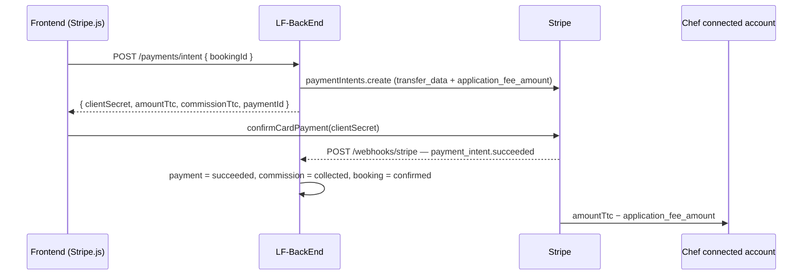
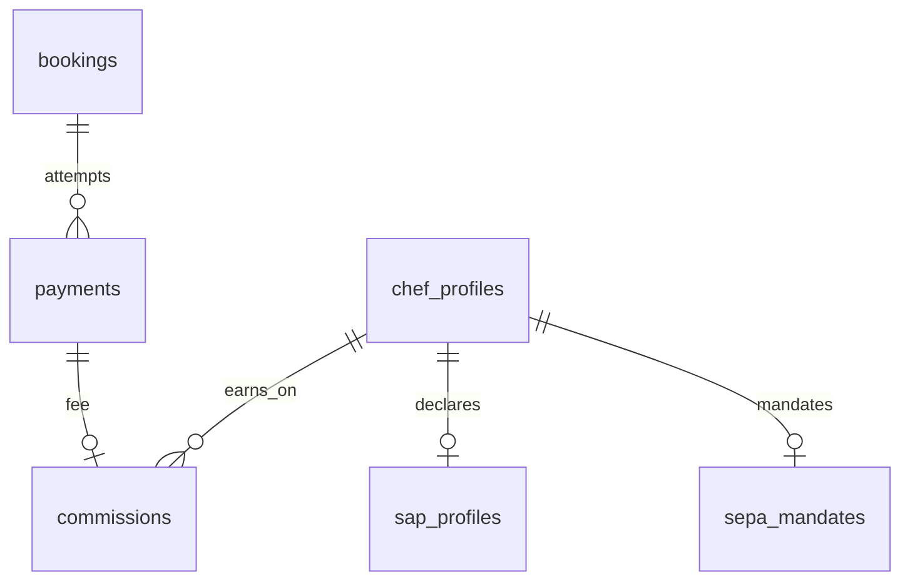

# Stripe payments — integration contract

How money moves through LF-BackEnd: card payment on a booking, the platform
commission, chef Stripe Connect onboarding, the commission direct-debit mandate, and
the "service à la personne" (SAP) fiscal data.

Companion documents: [`../auth/clerk-integration-contract.md`](../auth/clerk-integration-contract.md)
(who the caller is), [`../evolution/payments-stripe-cb-evolution.md`](../evolution/payments-stripe-cb-evolution.md)
(what changed and why), [`../SPEC-BACKEND.md`](../SPEC-BACKEND.md) §4.3 (product intent).

## 1. Model in one paragraph

A card payment is a **Stripe Connect destination charge**. The client is charged on the
**platform** account; Stripe forwards the amount to the chef's **connected account**
minus `application_fee_amount`, which the platform keeps as its commission. The
commission is therefore collected atomically with the payment — there is no second
debit, and no payout job to run. The backend never sees card details: it hands the
frontend a `client_secret`, and the booking only becomes `confirmed` when the
`payment_intent.succeeded` webhook arrives.



## 2. Prerequisites per role

| Actor | Must have | How |
|-------|-----------|-----|
| Client | Clerk session, a `pending` booking they own | `POST /bookings` |
| Chef | `chef_profiles` row | `PATCH /me/chef-profile` |
| Chef | Connect account with `chargesEnabled` **and** `payoutsEnabled` | `POST /me/chef-profile/stripe-connect/link`, then Stripe hosted onboarding |
| Platform | `STRIPE_SECRET_KEY`, `STRIPE_WEBHOOK_SECRET` | see §6 |

A booking whose chef has not finished onboarding is **not payable** — `POST /payments/intent`
answers `409`. Surface the chef's onboarding state in the chef app before the client
ever reaches checkout.

## 3. Endpoints

All routes below require a Clerk bearer token unless stated otherwise. Amounts are
integers in **minor units** (cents) and currencies are ISO 4217.

### Client — pay a booking

| Method | Path | Auth |
|--------|------|------|
| `POST` | `/payments/intent` | Clerk (booking owner) |

```jsonc
// request
{ "bookingId": "c2eebc99-9c0b-4ef8-bb6d-6bb9bd380a33" }

// 200
{
  "paymentId": "…",        // local payments.id for this attempt
  "clientSecret": "pi_3Ab…_secret_xyz",
  "amountTtc": 12500,
  "currency": "EUR",
  "commissionTtc": 2250    // what the platform withholds; the chef gets the remainder
}
```

| Status | Cause |
|--------|-------|
| `404` | Booking unknown, or not owned by the caller |
| `409` | Booking is not `pending`; already paid; chef onboarding incomplete; amount ≤ 0 |
| `503` | `STRIPE_SECRET_KEY` missing |

**Idempotency.** Calling it twice for the same booking returns the existing pending
intent instead of creating a second one. A Stripe-side intent that can no longer be
confirmed (cancelled, expired) is dropped and a fresh one is created. If Stripe already
reports the intent as `succeeded` while the webhook is still in flight, the call answers
`409 This booking has already been paid` rather than double-billing.

### Chef — Stripe Connect onboarding

| Method | Path | Returns |
|--------|------|---------|
| `POST` | `/me/chef-profile/stripe-connect/link` | `{ "url": "https://connect.stripe.com/setup/e/acct_…" }` |
| `GET` | `/me/chef-profile/stripe-connect/status` | `{ stripeAccountId, chargesEnabled, payoutsEnabled, detailsSubmitted }` |

The Express account (`country: FR`, capabilities `card_payments` + `transfers`) is
created on the first `link` call. **Account links are single-use and short-lived — never
cache the URL**; request a new one each time the chef resumes onboarding. `business_type`
is intentionally left unset so Stripe's hosted form can ask (a chef may be a
micro-entreprise or a company).

`status` reads Postgres, not the Stripe API: the three flags are mirrored from the
`account.updated` webhook. Poll it while the chef is in the hosted flow. Both routes
answer `409` before `PATCH /me/chef-profile` has run.

Redirects are configured with `STRIPE_CONNECT_RETURN_URL` and
`STRIPE_CONNECT_REFRESH_URL` (see §6) — they point at batchcooking-web.

### Chef — commission direct-debit mandate (SEPA)

| Method | Path | Returns |
|--------|------|---------|
| `POST` | `/me/chef-profile/sepa-mandate/setup-intent` | `{ "clientSecret": "seti_…_secret_…" }` |
| `GET` | `/me/chef-profile/sepa-mandate` | `{ status, ibanLast4, signedAt }` or `null` |

> **Nothing is ever debited by this phase.** The mandate is groundwork for the
> *avance immédiate* and *CESU* flows, where the commission cannot be split at charge
> time. **Card payments do not need it** — Stripe Connect already withholds their
> commission.

The frontend collects the IBAN with Stripe Elements and confirms the SetupIntent there;
the IBAN never reaches this backend. `setup_intent.succeeded` flips the mandate to
`active` and stores the mandate id plus the **last four digits** of the IBAN — the only
part of the bank details persisted here. Stripe's `sepa_debit` payment method is the
SEPA **CORE** scheme (the B2B scheme is not exposed by the API).

Mandate lifecycle: `pending → active`, with `revoked` and `failed` as exit states.

### Chef — "service à la personne" declaration

| Method | Path | Notes |
|--------|------|-------|
| `GET` | `/me/chef-profile/sap` | `null` when not declared yet |
| `PATCH` | `/me/chef-profile/sap` | Upsert; lives in `UsersModule`, not `PaymentsModule` |

Two declaration routes:

| `declarationType` | Required fields | Meaning |
|-------------------|-----------------|---------|
| `type_a_nova` | `novaCode` | The chef holds their own NOVA declaration |
| `type_b_cooperative` | `cooperativeName`, `cooperativeMembershipProof` | The chef declares through a cooperative (Unipros-style) |

`crcesuNan` is optional on both. Switching type **clears the other type's fields**, so a
cooperative chef cannot keep a stale NOVA code.

`urssafTiersPrestationStatus` and `crcesuAffiliationStatus` are **not writable** — same
rule as `isActive` / `isVerified` on `chef_profiles`: a chef must not declare themselves
habilitated. Both stay `not_started` until the URSSAF / CRCESU integrations exist.

### Fiscal attestations (50 % tax credit)

| Method | Path | Auth |
|--------|------|------|
| `GET` | `/me/fiscal-attestations/:year` | Clerk |
| `GET` | `/admin/fiscal-attestations?year=` | Admin |
| `GET` | `/admin/fiscal-attestations/:clientId?year=` | Admin |

```jsonc
{
  "clientId": "…", "clientName": "…", "clientEmail": "…",
  "year": 2026,
  // Sum across providers — a dashboard figure, NOT a filable document.
  "eligibleAmountCents": 48000, "paymentsCount": 4, "currency": "EUR",
  "providers": [
    {
      "chefProfileId": "…", "chefDisplayName": "Chef Marie D.",
      "sapDeclared": true, "declarationType": "type_a_nova",
      "novaCode": "SAP123456789", "cooperativeName": null,
      "eligibleAmountCents": 30000, "paymentsCount": 3, "currency": "EUR"
    }
  ]
}
```

**The chef is the declared provider (prestataire), so one attestation is issued per
entry in `providers`** — each carrying that chef's own declaration (`novaCode` for
`type_a_nova`, `cooperativeName` for `type_b_cooperative`). The client-level totals
aggregate every provider and exist for dashboards only: no single document may cover
amounts owed by several independent providers. `providers` is sorted by amount,
largest first.

A provider with `sapDeclared: false` has no `SapProfile` and **cannot issue an
attestation at all** — surface that to the client rather than counting the amount as
claimable.

Only `succeeded` payments count, and the **tax year is decided by `paidAt`**, not
`createdAt` — an intent created on 31 December and settled on 1 January belongs to the
later year. A refunded payment therefore drops out of the total on its own. `year`
defaults to the current UTC year on the admin routes; clients with no succeeded payment
that year are omitted from the list.

**JSON only — no signed PDF is rendered yet.** Pending validation of the legal
template; the per-provider shape above is the unit that template must render.

### Booking creation (now live)

`POST /bookings` no longer returns `501`. It persists a `pending` booking for the
authenticated client with a `LF-<year>-NNNN` reference, `amountTtc = priceCents`, and
`amountAfterTax = amountTtc / 2` (the 50 % SAP tax credit, SPEC-BACKEND §4.3). Shopping
list generation, notifications, and the `cooking` / `delivered` transitions remain out of
scope. `chefId` wins over the legacy `providerId` alias when both are sent.

## 4. Webhook — `POST /webhooks/stripe`

Public, unauthenticated, verified by the `stripe-signature` header against the **raw
request bytes**. The Fastify `preParsing` hook in [`apps/src/main.ts`](../../apps/src/main.ts)
captures the raw body for the paths listed in
[`apps/src/auth/fastify-raw-body.ts`](../../apps/src/auth/fastify-raw-body.ts) — a
re-serialised JSON body fails verification. Excluded from Swagger
(`@ApiExcludeController`).

| Event | Effect |
|-------|--------|
| `payment_intent.succeeded` | payment → `succeeded` (+ `paidAt`, charge id, `taxCreditEligibleAmount`), commission → `collected`, booking → `confirmed` |
| `payment_intent.payment_failed` | payment → `failed` with the Stripe reason, commission → `failed`; **booking stays `pending`** so the client can retry |
| `charge.refunded` | payment → `refunded` or `partially_refunded`, records `refundedAmount` / `refundedAt` |
| `account.updated` | Mirrors `charges_enabled`, `payouts_enabled`, `details_submitted` onto `chef_profiles` |
| `setup_intent.succeeded` | SEPA mandate → `active` with mandate id and `ibanLast4` |

Anything else is logged at debug level and ignored.

**Idempotency.** Stripe delivers each event at least once and retries anything that is
not 2xx, so every handler is a no-op on a second delivery: a payment already `succeeded`
is skipped, a late `payment_failed` cannot undo a settled payment, an unchanged refund
amount is not rewritten, and `account.updated` is an `updateMany` keyed on the account id
(also a no-op for accounts this platform does not know).

**Refunds are passive bookkeeping.** This phase issues no refunds itself, and
`Commission.status` is deliberately left untouched on a refund: Stripe does not refund
the `application_fee_amount` unless explicitly asked, so the commission really was
collected. Clawing it back belongs with an admin refund flow that does not exist yet.

Failure responses: `400` on a missing/invalid signature or missing raw body, `503` when
`STRIPE_SECRET_KEY` or `STRIPE_WEBHOOK_SECRET` is unset.

## 5. Commission arithmetic

Implemented in [`apps/src/modules/payments/commission.util.ts`](../../apps/src/modules/payments/commission.util.ts).
Rates are in **basis points** (1500 = 15 %).

```
amountHtCents  = round(amountTtc  × rateBps    / 10 000)
amountVatCents = round(amountHtCents × vatRateBps / 10 000)
amountTtcCents = amountHtCents + amountVatCents   → application_fee_amount
```

- VAT is computed from the **rounded HT amount**, not from the base, so
  `HT + VAT === TTC` always holds — an invoice that does not add up would be a
  bookkeeping problem.
- The result is **clamped to the charge amount**: Stripe rejects a fee larger than the
  charge, and a misconfigured rate must not make every payment fail. On clamping, HT is
  derived back from the capped total so the three figures stay consistent.
- A **zero** commission sends no `application_fee_amount` at all — Stripe rejects a zero fee.
- `rateBps` and `vatRateBps` are **frozen onto the `commissions` row** at creation time,
  so changing the configured rate never rewrites history and an audit can replay the amounts.

> **15 % HT** is the contracted rate, carried as the `PAYMENTS_COMMISSION_RATE_BPS`
> default. Override it per environment only to model a different agreement — the rate
> in force is frozen onto each `Commission` row, so a change never rewrites history.

## 6. Configuration

| Variable | Default | Purpose |
|----------|---------|---------|
| `STRIPE_SECRET_KEY` | — | Platform secret key. Unset → payment routes answer `503` |
| `STRIPE_WEBHOOK_SECRET` | — | `whsec_…` used to verify `POST /webhooks/stripe` |
| `PAYMENTS_COMMISSION_RATE_BPS` | `1500` | Commission on the pre-VAT base, in bps (contracted 15 % HT) |
| `PAYMENTS_COMMISSION_VAT_RATE_BPS` | `2000` | VAT on the commission, in bps (French standard rate) |
| `STRIPE_CONNECT_RETURN_URL` | `http://localhost:3005/chef/onboarding/stripe/return` | Where Stripe sends a chef who finished (or abandoned) onboarding |
| `STRIPE_CONNECT_REFRESH_URL` | `http://localhost:3005/chef/onboarding/stripe/refresh` | Where Stripe sends a chef whose onboarding link expired |

Port 3005 is batchcooking-web (see [`apps/src/config/allowed-origins.ts`](../../apps/src/config/allowed-origins.ts)).
Validation lives in [`apps/src/config/env.validation.ts`](../../apps/src/config/env.validation.ts)
(bps values are bounded to `0…10 000`); the typed shape is `payments.*` in
[`apps/src/config/config.loader.ts`](../../apps/src/config/config.loader.ts).

### Stripe Dashboard

Register the endpoint at `POST https://<api-host>/webhooks/stripe` with exactly these
events: `payment_intent.succeeded`, `payment_intent.payment_failed`, `charge.refunded`,
`account.updated`, `setup_intent.succeeded`.

Connect must be enabled on the account (Express accounts, FR).

### Local development

```bash
stripe listen --forward-to localhost:8000/webhooks/stripe   # prints the whsec_… secret
stripe trigger payment_intent.succeeded
```

Put the printed secret in repo-root `.env` as `STRIPE_WEBHOOK_SECRET`. Note the env
precedence warning in [`AGENTS.md`](../../AGENTS.md): repo-root `.env.local` **overrides**
shell-exported variables.

## 7. Data model



- **`payments` is not unique on `booking_id`** — a failed card attempt must be retryable
  with a fresh PaymentIntent, so a booking may carry several rows. The most recent
  non-`failed` row is the live attempt. `stripe_payment_intent_id` is unique and starts
  `NULL` (the row exists before the intent is created).
- **`commissions`** is 1:1 with a payment and denormalises `chef_profile_id`, because
  "commission generated by chef X" is a recurring admin query.
- `payment_status` reuses the pre-existing `pending` / `paid` / `refunded` values and adds
  `succeeded`, `failed`, `partially_refunded`. The flow written by this phase is
  `pending → succeeded`; **`paid` is reserved for the invoiceable step and is not set by
  any code path yet**.
- `payments.metadata` (JSONB) is a deliberate extension slot for the avance immédiate /
  CESU flows, so those do not need a throwaway migration.

Migration: `apps/prisma/migrations/20260831120000_payments_sap_sepa_foundations/`. It
**alters** the `payments` table and `payment_status` enum inherited from
`20250522130000_spec_domain` rather than creating them, inverts the old
`bookings.payment_id` 1:1 link into `payments.booking_id`, and drops `payments.user_id`
(the payer is reachable through `bookings.client_id`). Every statement is idempotent —
Prisma does not wrap a migration file in a transaction, so a mid-file failure commits
everything before it and `migrate deploy` replays from the top. See the header comment in
the migration for the full rationale.

> **Data loss on legacy rows:** the backfill attaches old `payments` rows to a booking via
> `bookings.payment_id`, then via `bookings.stripe_payment_intent_id`. Rows that match
> neither are **deleted**, because `booking_id` is `NOT NULL`. Check a production dump
> before deploying if legacy payment rows matter.

## 8. Known limitations

| Limitation | Consequence |
|------------|-------------|
| No PDF attestation | `GET …/fiscal-attestations` returns JSON only |
| No refund endpoint | Refunds happen in the Stripe Dashboard; the webhook records them, the commission is not clawed back |
| `avance immédiate` / CESU | Enums, `payments.metadata`, and the SEPA mandate exist; **no flow is implemented** |
| URSSAF / CRCESU statuses | Inert admin-maintained metadata; no integration writes them, and no admin route sets them yet |
| No admin payments list | `/admin/payments`, `/admin/commissions` do not exist |
| Email verification is off | Nothing proves address ownership — flagged as a pre-payments risk in the [Clerk contract](../auth/clerk-integration-contract.md) and **still open** |
| `is_active` / `is_verified` unread | An unvetted chef who completes Connect onboarding can be paid; booking assignment must filter on both |
