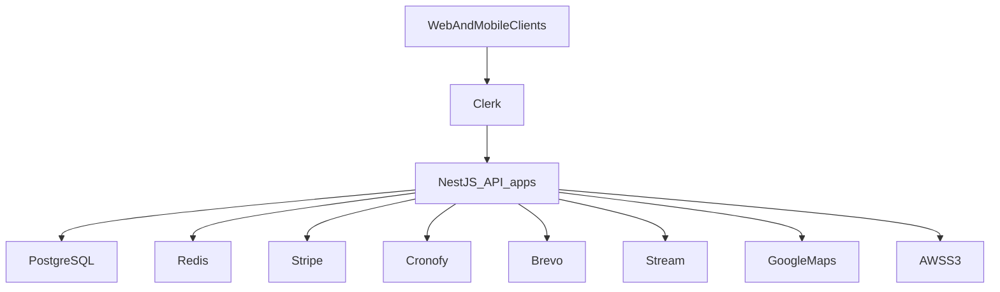

# Labs Food — Backend stack

Monolithic **NestJS** API (REST + OpenAPI/Swagger), containerised with Docker, shared by all Lab's Food web clients. Product scope and API contracts are defined in [`docs/SPEC-BACKEND.md`](./docs/SPEC-BACKEND.md) and [`docs/SPEC-ADMIN-DASHBOARD.md`](./docs/SPEC-ADMIN-DASHBOARD.md) (backend sections only).

## Application

| Layer | Choice |
|-------|--------|
| Runtime | Node.js 20 |
| Framework | NestJS 11 + **Fastify** adapter |
| API style | REST controllers, `@nestjs/swagger` |
| Persistence | PostgreSQL 16 (Supabase-hosted or local Docker) |
| ORM / migrations | **Prisma 7.6** — `apps/prisma.config.ts` + `apps/prisma/schema.prisma` |
| Cache / queues | Redis 7 (scaffolded, not wired yet) |
| Repo path | [`apps/`](./apps/) — NestJS source (`apps/src/`) |

## Authentication & roles

| Topic | Choice |
|-------|--------|
| Auth provider | [Clerk](https://clerk.com/) (OAuth2 / sessions); API validates Bearer tokens via `ClerkAuthGuard` |
| Roles | `client`, `chef`, `admin` |
| Admin authorization | `AdminGuard` + persisted `UserRole.ADMIN` |

## Integrations

| Domain | Service | Role in backend |
|--------|---------|-----------------|
| Payments | [Stripe](https://stripe.com/) | Booking/checkout payment intents, webhooks |
| Calendar | [Cronofy](https://www.cronofy.com/) | Chef availability / scheduling |
| Messaging | [Stream](https://getstream.io/) | Client ↔ chef realtime threads |
| Email | [Brevo](https://www.brevo.com/) | Transactional notifications |
| Maps | Google Maps API | Zones, routing (when needed) |
| Object storage | AWS S3 (+ optional Supabase Storage for CMS assets) | Meal images, application documents |
| Hosting | Railway | API + Postgres + Redis containers |

## Domain naming (resolved)

| Spec / legacy term | Backend choice |
|--------------------|----------------|
| `Reservation` (spec) | Keep **`bookings`** table/module naming |
| `provider` (legacy) | Migrated to **`chef`** (E1) |
| Spec email/password JWT | **Clerk** remains the auth source; no `/auth/register` routes in API |
| Spec Prisma examples | **Prisma** is the target ORM (replacing interim TypeORM in `apps/`) |

## Runtime flow

1. Clients authenticate with **Clerk** and call the NestJS API with a Bearer token.
2. The API persists domain data in **PostgreSQL** (bookings, catalog, CRM, Kossam, etc. per specs).
3. **Redis** will back cache and async jobs (email, notifications) when enabled.
4. **Stripe**, **Cronofy**, **Brevo**, and **Stream** are invoked from integration services under `apps/src/integrations/`.

## Related documentation

| Document | Purpose |
|----------|---------|
| [`docs/architecture.md`](./docs/architecture.md) | Backend modules, data model direction, endpoints (no frontend UI) |
| [`docs/evolution/platform-spec-alignment-evolution.md`](./docs/evolution/platform-spec-alignment-evolution.md) | Spec gap analysis, decisions, backlog |
| [`AGENTS.md`](./AGENTS.md) | Local dev and agent instructions |
| [`docs/database-connection.md`](./docs/database-connection.md) | Supabase pooler vs direct URLs |
