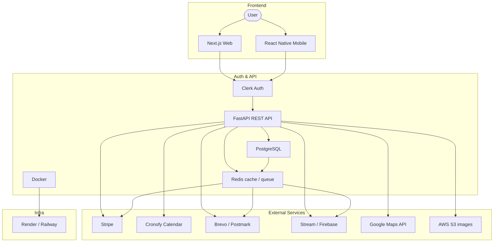

# Schema

Architecture monolith, backend mise à dispostion

- FastAPI model-controller + route via swagger API, et
- conteneurisation docker

### Technos

- GitHub
- Authentification OAuth2 (par services Google/apple) => Clerk or clerk
- Agenda => Cronofy
- Communication => Stream ou Firebase
- Envoi mail => Brevo 300mails/jrs **gratuit** ou postmark 98% en **deliverabilty inbox**

### Infra et services tiers

- Hébergement => Render ou Railway
- Paiement (Stripe)
- Cartographie (GoogleMaps API)
- Stockage images (AWS S3)

### Langages

- Frontend
  - Web Framework: NextJS
  - Mobile: React Native
  - Styles : TailwindCSS
- Backend
  - API => FastAPI in REST
  - Runtime/langage => NodeJs
  - Framework => NestJS + FastifyAdapter because NestJS(long-term) or Fastify(MVP purpose)

### Base de données

- BDD (PostgreSQL)
- Gestion cache (Redis)

### Flow Diagram

How the flow works

 1. User
  • Uses Next.js (web) or React Native (mobile).
  • Signs in via Clerk (OAuth2: Google/Apple).
  • Creates/updates bookings → API → FastAPI.
 2. Backend (FastAPI / Django / NestJS)
  • FastAPI serves REST API (Swagger docs).
  • Uses PostgreSQL (Django ORM or SQLAlchemy) for: users, profiles, providers, bookings, availability.
  • Uses Redis for caching (slots, availability) and async job queues (sending emails, notifications).
 3. External services
  • Clerk: manages auth, sessions, OAuth, and user data.
  • Stripe: handles payments for bookings.
  • Cronofy: calendar sync for provider availability.
  • Brevo / Postmark: sends confirmation, reminders, and promo emails.
  • Stream / Firebase: real‑time chat between clients and masseurs.
  • Google Maps API: shows nearby providers and routes.
  • AWS S3: stores provider photos, IDs, document scans, etc.
 4. Deployment
  • All backend + DB + Redis run in Docker containers on Render or Railway.
  • Frontend (Next.js) is deployed separately (Vercel, Netlify, or Render).
  ![[Stack flow diagram.png]]

