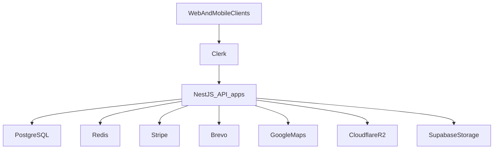

# Labs Food — Backend stack

Monolithic **NestJS** API (REST + OpenAPI/Swagger), containerised with Docker, shared by all Lab's Food web clients. Product scope and API contracts are defined in `docs/SPEC-BACKEND.md` and `docs/SPEC-ADMIN-DASHBOARD.md` (backend sections only), which are not in this repo: commit `559c4d6` removed them, read the last copy with `git show 559c4d6^:docs/SPEC-BACKEND.md`.

## Application

| Layer            | Choice                                                                 |
| ---------------- | ---------------------------------------------------------------------- |
| Runtime          | Node.js 22                                                             |
| Framework        | NestJS 11 + **Fastify** adapter                                        |
| API style        | REST controllers, `@nestjs/swagger`                                    |
| Persistence      | PostgreSQL 16 (Supabase-hosted or local Docker)                        |
| ORM / migrations | **Prisma 7.6** — `apps/prisma.config.ts` + `apps/prisma/schema.prisma` |
| Realtime / limits | Redis 7, optional: messaging rate limit and WebSocket fan-out between instances |
| Repo path        | [`apps/`](./apps/) — NestJS source (`apps/src/`)                       |

> **Node version.** The image builds on `node:22-alpine` ([`apps/Dockerfile`](./apps/Dockerfile)), but
> `.nvmrc` and `apps/.nvmrc` still say `20`, so nvm and the CI lint and test job (`setup-node` reads
> `.nvmrc`) run Node 20. The unmerged branch `fix/node-pin-db-tls` pins Node 22.23.4 in all three
> and makes CI check they agree.

## Authentication & roles

| Topic               | Choice                                                                                            |
| ------------------- | ------------------------------------------------------------------------------------------------- |
| Auth provider       | [Clerk](https://clerk.com/) (OAuth2 / sessions); API validates Bearer tokens via `ClerkAuthGuard` |
| Roles               | `client`, `chef`, `admin`                                                                         |
| Admin authorization | `AdminGuard` + persisted `UserRole.ADMIN`                                                         |

## Integrations

| Domain         | Service                                                                                                                                      | Role in backend                                 |
| -------------- | -------------------------------------------------------------------------------------------------------------------------------------------- | ----------------------------------------------- |
| Payments       | [Stripe](https://stripe.com/)                                                                                                                | **Connect destination charges** (Checkout page or PaymentIntent), platform commission as `application_fee_amount`, chef Express onboarding, SEPA mandates and commission debits, `POST /webhooks/stripe` |
| Calendar       |  |
| Messaging      | In-house: `modules/messaging` (PostgreSQL, REST, `/ws` WebSocket) | Client ↔ chef and support conversations |
| Email          | [Brevo](https://www.brevo.com/)                                                                                                              | Transactional notifications                     |
| Maps           | Google Maps API                                                                                                                              | Key configured (`GOOGLE_MAPS_API_KEY`), not used yet |
| Object storage | [Cloudflare R2](https://developers.cloudflare.com/r2/) (public, S3-compatible) for photos; Supabase Storage (private) for documents | Dish, menu and profile photos (no egress fee); chef KYC documents and message attachments |
| Hosting        | Railway                                                                                                                                      | API container (Postgres on Supabase; Redis plugin once the API runs on more than one instance) |

## Domain naming (resolved)

| Spec / legacy term      | Backend choice                                                       |
| ----------------------- | -------------------------------------------------------------------- |
| `Reservation` (spec)    | Keep **`bookings`** table/module naming                              |
| `provider` (legacy)     | Migrated to **`chef`** (E1)                                          |
| Spec email/password JWT | **Clerk** remains the auth source; the API owns sign-up (`POST /auth/register`), never sign-in |
| Spec Prisma examples    | **Prisma** is the ORM (TypeORM removed)                              |

## Runtime flow

1. Clients authenticate with **Clerk** and call the NestJS API with a Bearer token.
2. The API persists domain data in **PostgreSQL** (users and profiles, candidatures, dishes and menus, quotes, bookings, conversations, payments, audit log).
3. **Redis** carries the messaging rate limit and the realtime events between API instances; without `REDIS_URL` both stay in-process.
4. **Stripe**, **Brevo**, **Clerk**, **Cloudflare R2** and **Supabase Storage** are invoked from integration services under `apps/src/integrations/`. Messaging is not an integration: it lives in `apps/src/modules/messaging/`.

## Related documentation

| Document                                                                                                       | Purpose                                                           |
| -------------------------------------------------------------------------------------------------------------- | ----------------------------------------------------------------- |
| [`docs/architecture.md`](./docs/architecture.md)                                                               | Backend modules, data model direction, endpoints (no frontend UI) |
| `docs/evolution/platform-spec-alignment-evolution.md` (not in the repo since `559c4d6`)                        | Spec gap analysis, decisions, backlog                             |
| [`AGENTS.md`](./AGENTS.md)                                                                                     | Local dev and agent instructions                                  |
| [`docs/database-connection.md`](./docs/database-connection.md)                                                 | Supabase pooler vs direct URLs                                    |
